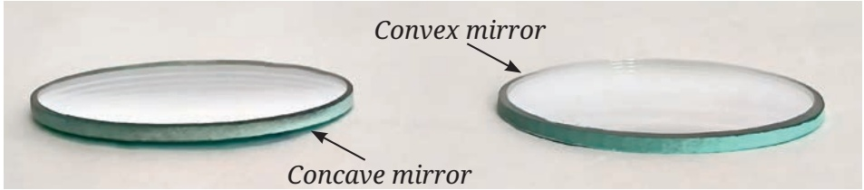
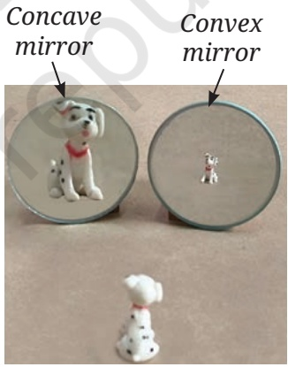
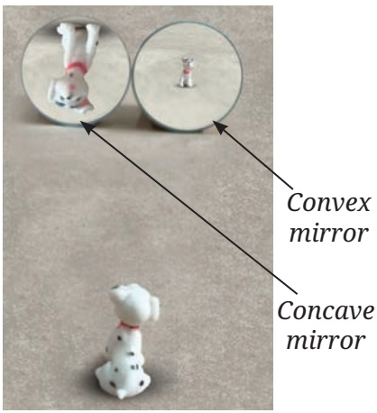

**Chapter 10 — Light: Mirrors and Lenses**

## Activity 10.2: Let us distinguish

Place concave and convex mirrors on a table with their reflecting surfaces facing upwards.

z Now view them from the side, keeping your eye at their level, to **identify** whether the reflecting surface is curved inwards or outwards (Fig. 10.4).

How can we distinguish between concave and c<u>onvex mirrors?</u>

Fig. 10.4: Identifying concave and convex mirrors from their side view

## 10.2 What Are the Characteristics of Images Formed by Spherical Mirrors?

## Activity 10.3: Let us explore

Take a concave mirror, a convex mirror, two small wooden blocks or something similar to place the mirrors in an upright position, and a small toy or some other object.

Place the two mirrors side by side in an upright position on a table. Keep the object in front of them at a small distance (3–4 cm away) as shown in Fig. 10.5a. What kind of images do you see in each mirror? Are the images of the same size as the object? Are they erect? Do you see lateral inversion in the images?

(a)

(b)

Fig. 10.5: An object placed in front of concave and convex mirrors at (a) Small distance; (b) Large distance

Write down your observations in your notebook.

z Now slowly move the object away from the mirrors (Fig. 10.5b). What changes do you see in the images in both the mirrors? Do the images become smaller or larger? Do they continue to be erect? Again, note down your observations.

z Repeat the steps with each mirror individually.

**Analyse** your observations and **draw conclusions**.