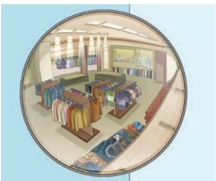
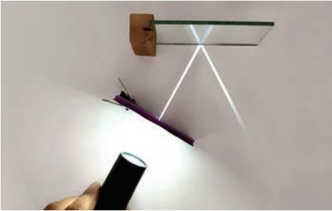
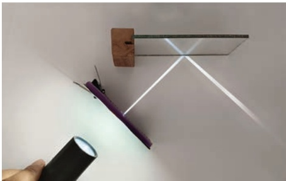

(a)

(b)

(c)

Fig. 10.7: Use of convex mirror as a (a) Side-view mirror; (b) Road safety mirror; (c) Surveillance mirror

convex mirror is curved outside, it provides a much wider area of the road behind. Further, such convex mirrors are installed at road intersections or sharp bends to <u>provide drivers from both</u> sides the visibility of the other side and prevent collisions (Fig. 10.7b). Convex mirrors are also installed in big stores to monitor a large area to deter thefts (Fig. 10.7c).

We have observed images formed by three types of mirrors—plane, concave, and convex. But are there any laws which govern the image formation?

## 10.3 What Are the Laws of Reflection?

Let us now repeat an activity which we did earlier in grade 7, but this time we will extend it further. Do you remember doing the activity for observing the reflection of a beam of light from a plane mirror?

## Activity 10.4: Let us experiment

Collect a plane mirror with stand, a torch, a comb, a paper clip to hold the comb upright, a sheet of white paper, and a strip of black paper.

z As you did earlier, make a thin slit by covering all openings of the comb using black paper, except for one in the middle.

z Spread a sheet of white paper on a table. Place the plane mirror upright on it.

Using the thin slit and torch, obtain a thin beam of light along the paper and adjust it to fall upon the mirror as shown in Fig. 10.8a.

z Now, move the slit and torch slightly so that the beam of light falls at a different angle on the mirror (Fig. 10.8b). Does the reflected beam of light also shift?

(a)

(b)

Fig. 10.8: A beam of light falling on a mirror (a) At one angle; (b) At another angle