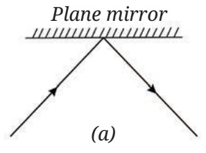
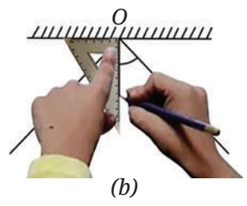
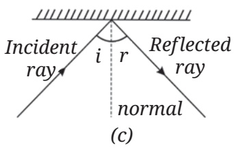
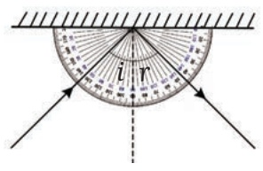

z Make the beam of light fall on the mirror at different angles and observe how the direction of the reflected beam changes.

To understand this better, let us **draw** this on a paper, step by step. But before doing that, let us learn how to represent light. We often represent light by straight lines with arrows, or **rays**. Rays indicate the path along which light travels. Do you remember learning earlier that the light travels along a straight line?

Draw a line showing the position of the plane mirror. Also, draw lines with arrows (rays) indicating the beam of light falling on the mirror and the reflected beam of light as shown in Fig. 10.9a.

The ray of light that falls on the mirror is called the **incident ray**. The ray of light that comes back from the mirror is called the **reflected ray**.

z Now remove the mirror. From the point where the incident ray strikes the mirror, draw a line making an angle of 90° to the line representing the mirror. This line is known as the **normal** to the reflecting surface at the point of incidence, O (Fig. 10.9b).

(d)

The angle between the normal and the incident ray is called the **angle of incidence** (i) (Fig. 10.9c). The angle between the normal and the reflected ray is known as the **angle of reflection** (r) (Fig. 10.9c).

On your drawing, **measure** the angle of incidence and the angle of reflection and note it in Table 10.1.

Fig. 10.9: (a) Drawing incident and reflected rays; (b) Drawing the normal; (c) Angle of incidence and angle of reflection;

(d) Measuring angles

Repeat the activity several times by changing the angle of incidence.

z Finally, let the incident beam fall on the mirror along the normal and observe the direction of the reflected beam. What would be the angle of incidence and angle of reflection in this case? Both the angles would be zero in this case.

~~Table 10.1: Measuring angles of inci~~dence and reflection

<table><tr><td rowspan=2>S.No.</td><td rowspan=2>Angle of incidence (i)</td><td></td></tr><tr><td>Angle of reflection (r)</td></tr><tr><td></td><td></td><td></td></tr><tr><td></td><td></td><td></td></tr><tr><td></td><td></td><td></td></tr><tr><td></td><td></td><td></td></tr></table>

Do you notice that both angles in Table 10.1 are nearly equal? If done carefully, the experiment shows that **the angle of incidence (i) is equal to the angle of reflection (r)**. This is a law of reflection.