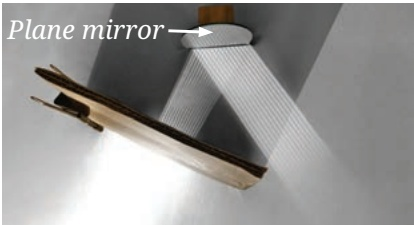
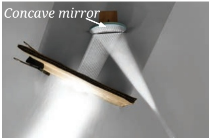
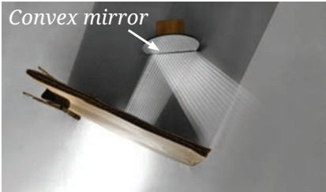
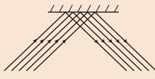
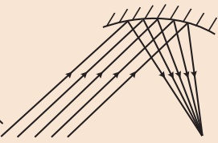
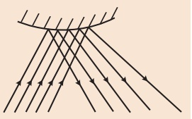

Are laws of reflection applicable to spherical mirrors also?

The laws of reflection are valid for all kinds of mirrors — plane and spherical. But if multiple parallel rays fall on the spherical mirrors, we observe something interesting.

(a)

(b)

(c)

(d)

## Activity 10.6: Let us explore

z Collect a plane mirror, a concave mirror, a convex mirror, stand for mirrors, a torch, a comb, and a paper clip to hold the comb upright.

z Use the same setup as Activity 10.4 again, but instead of a single slit, leave many openings of the comb uncovered to obtain multiple parallel beams of light (Fig. 10.11a).

z Let the multiple parallel beams of light fall upon the plane mirror, concave mirror, and convex mirror, one by one. Observe the reflected beams. Is your observation similar to what is shown in Fig. 10.11 (b), (c), and (d)?

When multiple parallel beams of light fall upon a plane mirror, the multiple reflected beams are also parallel (Fig. 10.11b). However, when multiple beams of light fall upon a concave mirror, the multiple reflected beams get closer, that is, they **converge** (Fig. 10.11c). Whereas, in the case of a convex mirror, the multiple reflected beams spread, that is, they **diverge** (Fig. 10.11d).

In the case of spherical mirrors, even though each ray of light follows the laws of reflection, the curved surface of spherical mirrors causes the parallel beam of rays to either converge (concave) or diverge (convex) on reflection depending on the shape of the mirror.

Fig. 10.11: (a) Multiple slits; Multiple parallel beams of light fall upon — (b) Plane mirror; (c) Concave mirror; (d) Convex mirror

## A step further

If we draw what we observed in Activity 10.6, we get the figures like those shown below.

Plane mirror

Concave mirror

Convex mirror