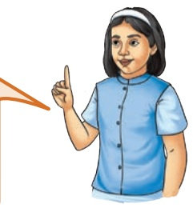
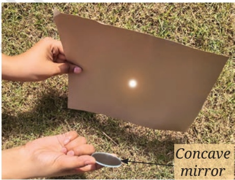

So, the concave mirror converges a light beam while the convex mirror diverges it. This is indeed interesting!

Since the concave mirror converges the light beam, wouldn’t light get concentrated in a small area?

## Activity 10.7: Let us explore

## Safety first

Always perform this activity under the supervision of a teacher or an adult. Do not look towards the Sun or into the mirror reflecting the Sun. Focus the reflected light only on a piece of paper, not towards anyone’s face or eyes.

Take a concave mirror and a sheet of thin paper or newspaper.

z Hold the concave mirror with its reflecting surface facing the Sun. Direct the light of the Sun reflected by the mirror on the sheet of paper.

z Adjust the distance of the paper until you get a sharp bright spot on it as shown in Fig. 10.12.

Hold the mirror and the sheet of paper steady for a few minutes. Does the paper start to burn producing smoke?

Fig. 10.12: Converging sunlight on paper using a concave mirror

The bright spot is formed on the paper because light from the Sun, after reflection from the mirror, gets concentrated on this point. This produces sufficient heat at this point which can ignite the paper.

## A step further

Devices which concentrate sunlight into a small area, using mirrors and lenses, are called solar concentrators. The concentrated sunlight is used to heat a liquid to produce steam which can be used to generate electricity or for providing heat for various purposes, such as large scale cooking or for solar furnaces. Solar furnaces are even used for melting steel! Do you remember learning in an earlier chapter, about electric furnaces for melting steel?

