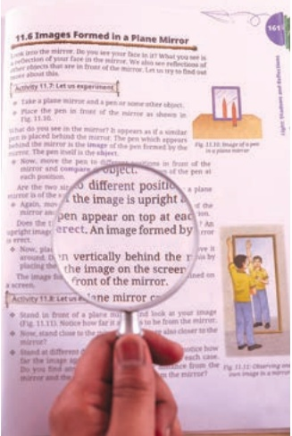
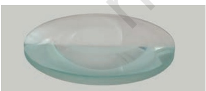
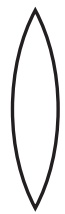
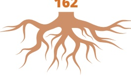

# 10.4 What Is a Lens?

We explored the images of an object formed by curved mirrors. But how do objects look when viewed through transparent materials with curved surfaces?

Imagine looking through a flat transparent glass window pane—all objects look the same size and shape. But would those objects continue to look the same if the surface of the transparent material is curved?

## SCIENCE

## Activity 10.8: Let us explore

## SCIENCE

## SCIENCE

z Collect a flat strip of glass or clear plastic, such as a flat scale, few drops of oil, dropper, water, and a paper or book with some text printed on it.

## SCIENCE

## SCIENCE

z Spread a few drops of oil on the surface of glass or plastic strip and rub it to leave a very thin coating. You can also use wax instead of oil.

## SCIENCE

SCIENCE

z Using a dropper or your finger, place a small drop of water on the oiled/waxed spot. (The oil/wax helps the water form a nice round drop.)

Fig. 10.13: View of text beneath the water drop

**Examine** the water drop. What is the shape of its surface? Is it flat or curved inward or curved outward?

z Place the paper underneath the glass/plastic strip such that the text is directly under the water drop (see Fig. 10.13).

z Now, look down through the water drop at the text below. Do you find some change in the size of the letters just below the water drop? Do they look enlarged or smaller?

The surface of the water drop is curved outside. The letters under the water drop look different— they might appear larger than the letters nearby! The curved surface of the water drop made the size of the text look different. This curved drop of water is acting like a simple lens. Have you seen a magnifying glass as shown in Fig. 10.14? It is also a lens that helps in reading small print by making the letters appear bigger.

Fig. 10.14: A magnifying glass

(a)

Fig. 10.15: (a) A convex lens; (b) Its representation

(b)

A **lens** is a piece of transparent material, usually made of glass or plastic, which has curved surfaces. Like mirrors, lenses can also be convex or concave.

A lens which is thicker at the middle as compared to the edges is called a **convex lens** (Fig. 10.15).

