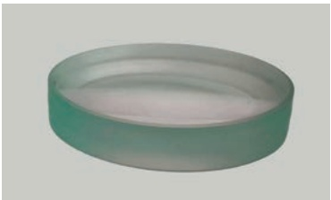
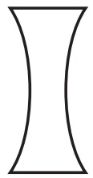
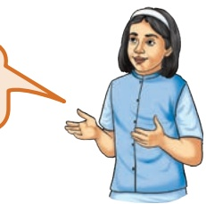
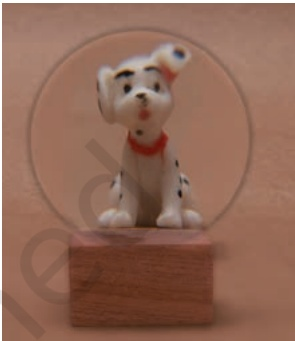
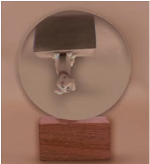
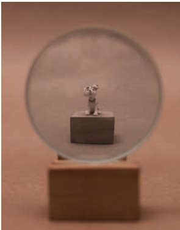
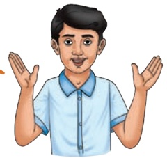

A lens which is thicker at the edges as compared to the middle is called a **concave lens** (Fig. 10.16).

Unlike mirrors, lenses allow light to pass through them, and we see things through a lens rather than in a lens.

(a)

(b)

What changes can be seen in the objects when viewed through lenses?

Fig. 10.16: (a) A concave lens; (b) Its representation

## Activity 10.9: Let us experiment

Collect a convex lens, a concave lens, a lens holder, and a small object.

z Take the convex lens and place it upright using its holder.

(a)

z Place the object behind the convex lens (it may also be placed on something to bring it up to the level of the lens).

z Look at the object through the lens from the other side of the lens (Fig. 10.17a) and note your observations in your notebook.

z Now slowly move the object farther from the lens and keep observing how the image changes (Fig. 10.17b). How does the distance of the object from the convex lens affect how it looks?

z Now repeat the steps using a concave lens (Fig. 10.17c).

z Analyse your observations recorded in your notebook and **compare** the images seen through both lenses. What conclusions do you draw?

When an object is placed behind a convex lens at a small distance from it and seen through the lens, the object appears erect and enlarged in size. As the distance between the object and the convex lens increases, the object appears inverted. It is initially enlarged in size and then diminishes in size. An object placed behind a concave lens and seen through the lens, always appears erect and diminished in size. Its size changes, as its distance from the lens increases.

(b)

(c)

Do lenses also converge or diverge the light beam?

Fig. 10.17: An object as seen through a (a) Convex lens placed at small distance; (b) Convex lens placed at large distance; (c) Concave lens