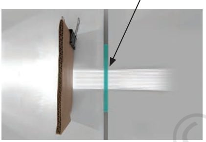
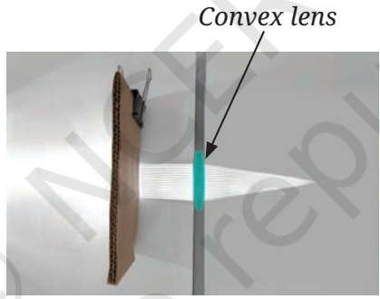
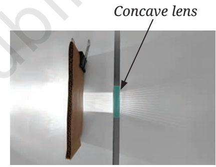
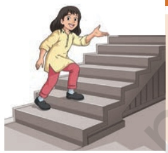
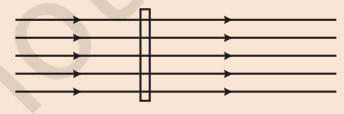
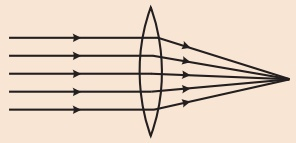
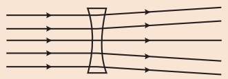
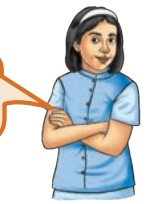

## Activity 10.10: Let us investigate

z Collect a thin transparent glass plate, a convex lens, a concave lens, a torch and a comb to obtain multiple parallel beams of light, a paper clip to hold the comb upright, two identical books, and sheets of white paper.

z Using two books placed adjacent to each other, fix the glass plate or lens upright in between them as shown in Fig. 10.18. Spread paper sheets on both books.

z Now let the multiple parallel beams of light fall upon the thin glass plate, convex lens, and concave lens one by one as shown in Fig. 10.18. Does the parallel beam of light pass through as it is in all three cases?

**Record** and analyse your observations.

The light beam passes through the thin glass plate as it is. The convex lens converges the light falling on it while the concave lens diverges the light. A convex lens is also called a **converging lens** while a concave lens is called a **diverging lens**.

Thin transparent glass plate

(a)

(b)

(c)

Fig. 10.18: Multiple parallel beams of light fall upon the (a) Thin glass plate; (b) Convex lens; (c) Concave lens

## A step further

If we draw what we observed in Activity 10.10, we get the figures like those shown below.

Since convex lens converges a light beam, can it also burn a paper?

