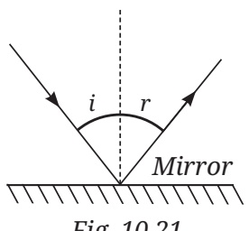
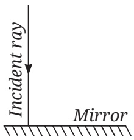
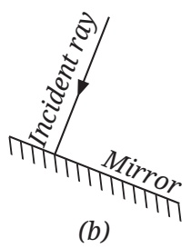
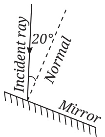
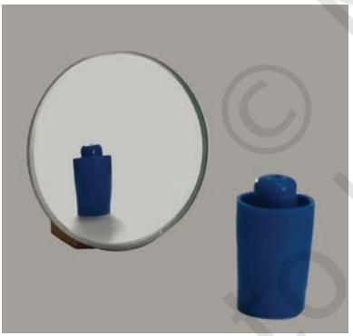
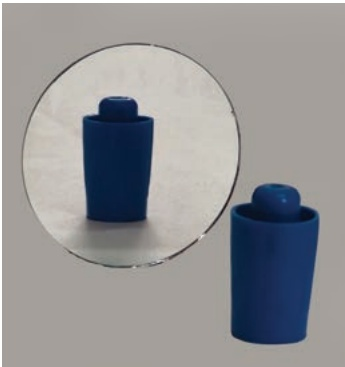

## Keep the curiosity alive

Fig. 10.21

1. A light ray is incident on a mirror and gets reflected by it (Fig. 10.21). The angle made by the incident ray with the normal to the mirror is $4 0 ^ { \circ }$ . What is the angle made by the reflected ray with the mirror? (i) $4 0 ^ { \circ }$ (ii) $5 0 ^ { \circ }$ (iii) $4 5 ^ { \circ }$ (iv) $6 0 ^ { \circ }$

2. Fig. 10.22 shows three different situations where a light ray falls on a mirror:

(i) The light ray falls along the normal.

(a)

Fig. 10.22

(c)

(ii) The mirror is tilted, but the light ray still falls along the normal to the tilted surface.

(iii) The mirror is tilted, and the light ray falls at an angle of $2 \bar { 0 } ^ { \circ }$ from the normal.

Draw the reflected ray in each case (Use a ruler and protractor for accurate drawing). What is the angle of reflection in each case?

3. In Fig. 10.23, the cap of a sketch pen is placed in front of three types of mirrors.

(i)

(ii)

Fig. 10.23

(iii)

Match each image with the correct mirror.

| Image | Mirror |
| --- | --- |
| (i) | Plane mirror |
| (ii) | Convex mirror |
| (iii) | Concave mirror |