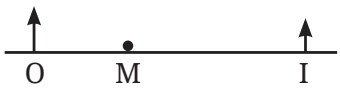
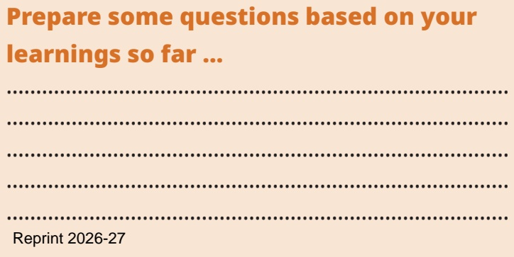

9. Match the entries in Column I with those in Column II.

| Column I | Column II |
| --- | --- |
| (i) Concave mirror | (a) Spherical mirror with a reflecting surface that curves inwards. |
| (ii) Convex mirror | (b) It forms an image which is always erect and diminished in size. |
| (iii) Convex lens | (c) Object placed behind it may appear inverted at some distance. |
| (iv) Concave lens | (d) Object placed behind it always appears diminished in size. |

10. The following question is based on Assertion/Reason. **Assertion:** Convex mirrors are preferred for observing the traffic behind us.

**Reason:** Convex mirrors provide a significantly larger view area than plane mirrors.

Choose the correct option:

(i) Both Assertion and Reason are correct and Reason is the correct explanation for Assertion.

(ii) Both Assertion and Reason are correct but Reason is not the correct explanation for Assertion.

(iii) Assertion is correct but Reason is incorrect.

(iv) Both Assertion and Reason are incorrect.

11. In Fig. 10.27, note that O stands for object, M for mirror, and I for image. Which of the following statements is true?

(i) Figure (a) indicates a plane mirror and Figure (b) indicates a concave mirror.

(ii) Figure (a) indicates a convex mirror and Figure (b) indicates a concave mirror.

indicates a convex mirror.

Fig. 10.27

(iv) Figure (a) indicates a plane mirror and Figure (b) indicates a convex mirror.

