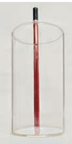
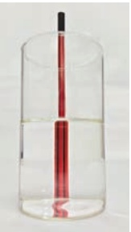
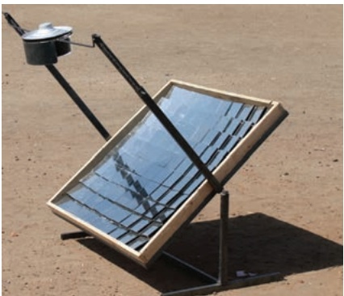
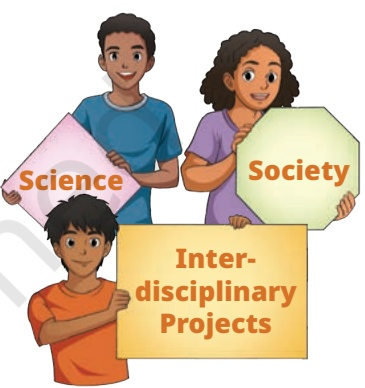

12. Place a pencil behind a transparent glass tumbler (Fig. 10.28a). Now fill the tumbler halfway with water (Fig. 10.28b). How does the pencil appear when viewed through the water? **Explain** why its shape appears changed.

## Discover, design, and debate

(a)

z Visit a nearby hospital or the clinic of an ENT specialist, or a dentist, with your teacher or parents. Request the doctor to show you the mirrors used for examining ear, nose, throat, and teeth. Identify the kind of mirror used in these instruments.

(b)

Fig. 10.29

z Harnessing sunlight is key to solving future energy challenges. In devices like solar cookers (Fig. 10.29), mirrors are used to converge sunlight and generate heat. In India, such designs are used in villages, thus saving electricity and reducing fossil fuel use. Think of a design for a solar cooker for your school or home and prepare a detailed proposal for it including the budget required.

Fig. 10.28

z Use online tools or animation to do virtual experiments with spherical mirrors and lenses. Move objects in the simulation and observe how the image changes.

## Our scientific heritage

More than 800 years ago, during the time of the great Indian mathematician Bhāskara II, astronomers used shallow bowls of water to observe the stars and planets. By carefully looking at their reflected images through tubes placed at appropriate angles, they could measure the positions of stars and planets in the sky. Even though the laws of reflection are not mentioned in literature, their instruments and methods indicate that they might have understood it in practice!

## Reflect on the questions framed by your friends and try to answer

