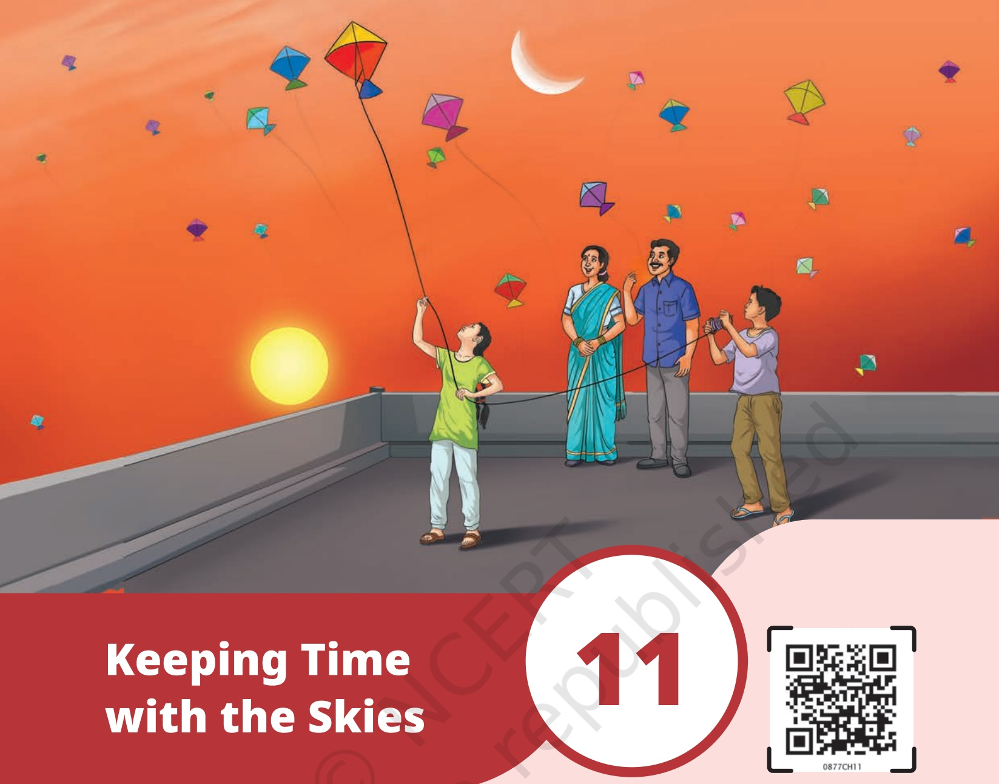

# Keeping Time with the Skies

z Have you ever seen the Moon during the day? Why do you think u think it is sometimes visible when the Sun is up?

z Imagine you lived on the Moon instead of Earth. What wou ld you mean by a day, a month or a year?

z What would happen if Earth had two moons instead of one? How would that change the night sky?

z If we didn’t have clocks or calendars, how else co ld u we measure time? C

z Share your questions

