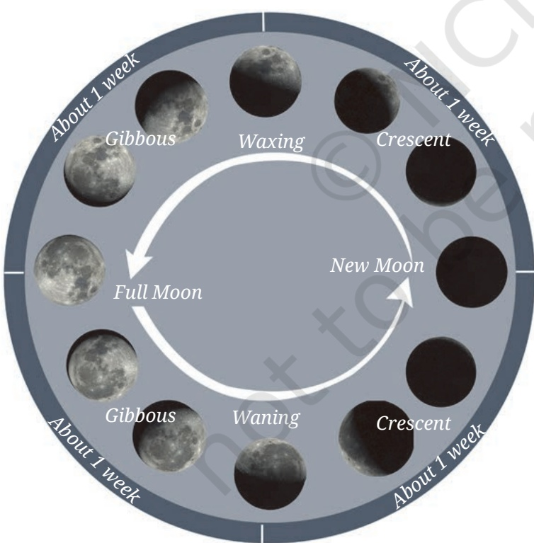

| Day | Date | Moon seen at | Appearance of the Moon in the sky | Size of the bright portion compared to the previous day | Moon and Sun separation in the sky compared to the previous day |
| --- | --- | --- | --- | --- | --- |
| 1. |  | Sunrise/Sunset |  | - | - |
| 2. |  | Sunrise/Sunset |  | IDneccrreeaasseedd/ | Closer/Farther |
| 3. |  | Sunrise/Sunset |  | IDneccrreeaasseedd/ | Closer/Farther |
|  |  |  |  |  |  |

Analyse the data recorded by you in Table 11.1. Did the Moon appear different each day? Was the Moon visible on all days? Did the Moon appear at the same position in the sky as on the previous day?

Fig. 11.2: Waxing (Shukla Paksha) and waning period (Krishna Paksha) of the Moon as viewed from the Earth

## 11.1.1 Phases of the Moon

You may have observed that the bright portion of the Moon decreases from a full circle to a half circle in about a week, as shown in Fig. 11.2. The bright portion continues to shrink for another week until it is no longer visible. This two-week period is called the **waning** period of the Moon. Different names are given to the Moon’s visible shapes during this cycle (Fig. 11.2). The day when the Moon appears as a full bright circle is called the **full Moon** day (or Purnima), and the day when it is not visible is called the **new Moon** day (or Amavasya).

After the new Moon, its bright side grows to a half circle in about a week and to a full circle (full Moon) in another week. The period when the bright part of the Moon increases is called the