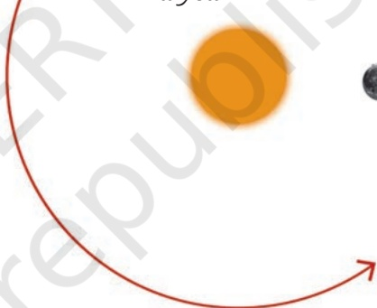
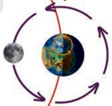

## ~~Table 11.2: Finding the duration~~ of a solar day

| Date | Time of s (hhho:rmtemst) shadow | Duration of day (hh:mm) |
| --- | --- | --- |
| 22 March 2025 | 12:20 | -- |
| 23 March 2025 | 12:20 | 24:00 |
| 24 March 2025 | 12:19 | 23:59 |

Find the average duration of the day. Is it nearly equal to 24 hours?

The phases of the Moon give us another natural cycle with a duration that is longer than a day. The Moon takes about 29.5 days (nearly a month) to cycle through all its phases. The cycle of the phases of the Moon is the basis for a **month**, another unit to measure time (Fig. 11.8).

The next larger unit to measure time is related to the natural cycle of seasons. Do you remember learning earlier that the Earth revolves around the Sun and takes nearly 365 and a quarter days to complete one revolution around the Sun? The Earth undergoes one cycle of seasons during this time, which can be used to define a **solar year** (Fig. 11.8).

Cycle of Earth’s seasons due to its revolution around the Sun define a year

Cycle of Moon’s phases due to its revolution around the Earth defines a month

Cycle of Sun returning to its highest position in the sky due to Earth’s rotation defines a day

Fig. 11.8: The Earth goes around the Sun, and the Moon revolves around the Earth in regular intervals of time.

## 11.2.1 Lunar calendars

In ancient times, people had noticed that during one cycle of seasons, one can fit nearly 12 cycles of the phases of the moon, that is, 12 lunar months. This is how **lunar calendars** came into being, with the day as the shortest unit, a month of nearly 29.5 days, and a lunar year consisting of 12 lunar months. The phases of the Moon thus gave an easy and a perfectly sound way to track the passage of time.

However, in a lunar calendar the seasons do not remain synchronised to the same lunar months in successive lunar years. The reason is that the seasons repeat in approximately 365 days while the lunar year is 354 days long.