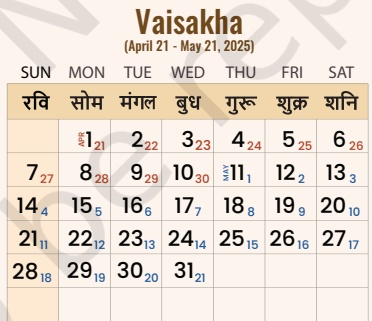

the accumulated difference becomes close to a full month. Therefore, every few years, an extra month (called Adhika Maasa or intercalary month) is added to the year in some calendars. This keeps the solar year and the lunar cycle in step. Such calendars are called **luni-solar calendars**. They combine elements from both the solar and the lunar calendars and are used in many parts of India.

## Ever heard of ...

You may have heard of the names (or similar sounding names) of the months in various Indian luni-solar calendars—Chaitra, Vaisakha, Jyeshtha, Ashadha, Shravana, Bhadrapada, Ashwin, Kartika, Margashirsha (or Agrahayan), Pausha, Magha, and Phalguna. In some communities, the new month starts on the first day after the new Moon and ends on the day of the new Moon. Such calendars are called Amant. In others, the start of the new month corresponds to the day after the full Moon, and the month ends on the full Moon. Such calendars are called Purnimant.

## 11.2.4 The Indian National Calendar

A national calendar by the Government of India is used along with Gregorian calendar for multiple official purposes.

## Chaitra (March 22 - April 20, 2025)

## Shaka Era 1947

<table><tr><td colspan=7>SUN MON TUE WED THU FRI SAT</td></tr><tr><td colspan=4></td><td colspan=3></td></tr><tr><td></td><td></td><td></td><td></td><td></td><td></td><td>11 22</td></tr><tr><td>223</td><td>324</td><td>425</td><td>526</td><td>627</td><td>728</td><td>829</td></tr><tr><td>930</td><td>10 31</td><td>11</td><td>12₂</td><td>133</td><td>144</td><td>155</td></tr><tr><td>16₆</td><td>178</td><td>187</td><td>1992</td><td>0102</td><td>111</td><td>2212</td></tr><tr><td>2313</td><td>24152</td><td>5142</td><td>6162</td><td>7172</td><td>8182</td><td>919</td></tr><tr><td>3020</td><td></td><td></td><td></td><td></td><td></td><td></td></tr></table>

Jyestha (May 22 - June 21, 2025)

<table><tr><td colspan=7>SUN MON TUE WED THU FRI SAT</td></tr><tr><td colspan=7>TT</td></tr><tr><td></td><td></td><td></td><td></td><td>1122</td><td>223</td><td>324</td></tr><tr><td>425</td><td>526</td><td>627</td><td>728</td><td>829</td><td>930</td><td>1031</td></tr><tr><td>111</td><td>122</td><td>133</td><td>144</td><td>155</td><td>16⁶</td><td>177</td></tr><tr><td>188</td><td>19g</td><td>2010</td><td>2111</td><td>2212</td><td>2313</td><td>2414</td></tr><tr><td>2515</td><td>2616</td><td>2717</td><td>2818</td><td>2919</td><td>3020</td><td>3121</td></tr><tr><td></td><td></td><td></td><td></td><td></td><td></td><td></td></tr></table>

Fig. 11.9: Indian National Calendar

It is a solar calendar (Fig. 11.9) consisting of 365 days in a year. The year begins on 22 March, which is the day after the spring equinox. Unlike the Gregorian calendar, months in the Indian National Calendar have either 30 or 31 days. The names of these months were taken from traditional Indian calendars. In a regular year, the second to sixth months have 31 days and the rest have 30 days. The leap years are matched to the Gregorian calendar by adding a day to Chaitra, the first month of the year. In such years, the new year begins on 21 March of the Gregorian calendar.