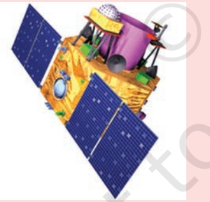
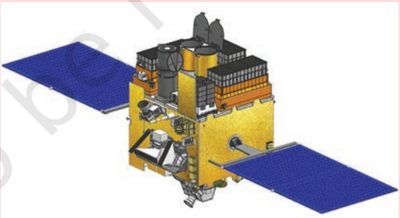

## 11.4 Why Do We Launch Artificial Satellites in Space?

The Moon is Earth’s natural satellite, orbiting our planet. Besides the Moon, man-made satellites sent by various countries also orbit the Earth. These **artificial satellites** appear as tiny specks moving in the night sky. Most orbit about 800 km above Earth’s surface and take roughly 100 minutes to complete one orbit.

When I look at the night sky in early evening, I see some moving stars. What are they? Is their motion also periodic?

These satellites help us in many ways like communication, navigation, weather monitoring, disaster management, and scientific research. The Indian Space Research Organisation(ISRO) has launched many satellites that support these activities.

## Our scientific heritage

The Cartosat series of satellites, launched by ISRO, capture high-quality images of the Earth to improve maps, plan cities, and handle natural disasters in India. One such mapping platform, Bhuvan, uses these images to show terrain, soil, land use, vegetation, and more.

AstroSat, another ISRO mission, makes scientific observations of stars and other celestial objects. India’s other space missions include Chandrayaan 1, 2, and 3 to the Moon; Aditya L1 to study the Sun; and Mangalyaan to Mars. ISRO also lets Indian students build and launch small satellites, such as AzaadiSat, InspireSat-1, and Jugnu.

Cartosat

AstroSat

## Activity 11.4: Let us identify

z Spotting an artificial satellite is a night sky watching activity like we have done previously. Just before sunrise or after sunset, go to a location, accompanied by an adult, that has a clear view of the sky, without any obstruction of trees or tall buildings.