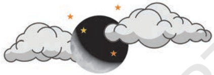
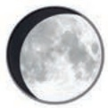
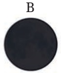
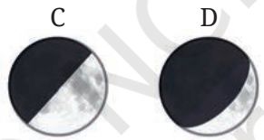
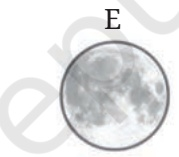
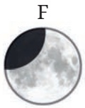

## Keep the curiosity alive

1. State whether the following statements are True or False.

(i) We can only see that part of the Moon which reflects sunlight towards us.

(ii) The shadow of Earth blocks sunlight from reaching the Moon causing phases.

(iii) Calendars are based on various astronomical cycles which repeat in a predictable manner.

(iv) The Moon can only be seen at night.

2. Amol was born on 6th of May on a full Moon day. Does his birthday fall on the full Moon day every year? Explain your answer.

3. Name two things that are incorrect in Fig. 11.10.

Fig. 11.10

4. Look at the pictures of the Moon in Fig. 11.11, and answer the following questions.

Fig. 11.11

(i) Write the correct panel number corresponding to the phases of the Moon shown in the pictures above.

<table><tr><td>Picture label (e.g. A, B, C, etc.)</td><td>Phase of Moon</td></tr><tr><td rowspan=2></td><td>Three days after New Moon</td></tr><tr><td>Full Moon</td></tr><tr><td></td><td>Three days after Full Moon</td></tr><tr><td></td><td>A week after Full Moon</td></tr><tr><td></td><td>Day of New Moon</td></tr></table>

(ii) List the picture labels of the phases of the Moon that are never seen from Earth. Hint: You can use your observations from Activity 11.1 or Fig. 11.2 as reference.

5. Malini saw the Moon overhead in the sky at sunset.

(i) **Draw** the phase of the Moon that Malini saw.

(ii) Is the Moon in the waxing or the waning phase?