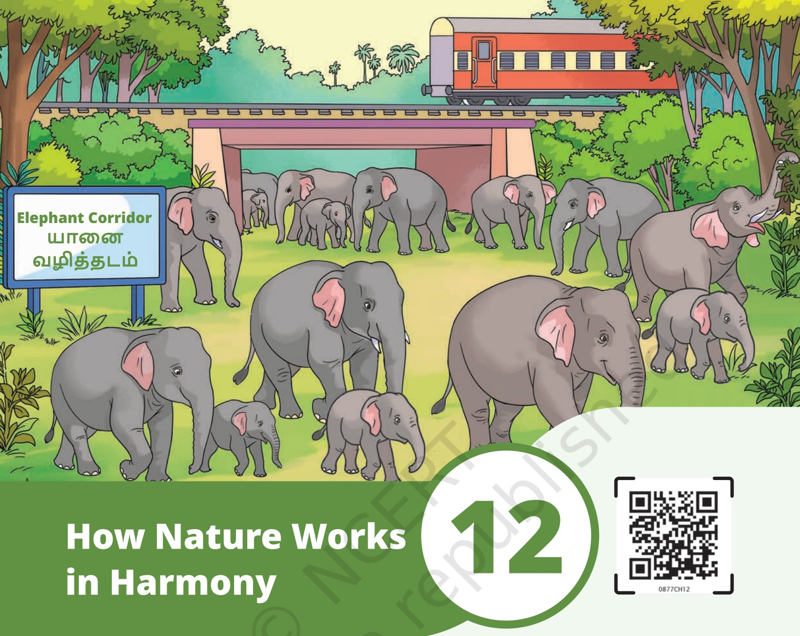

## How Nature Works in Harmony

# Probe and ponder

How might the loss of forest cover and changes in rainfall patterns lead to elephants to enter human farms and villages?

Imagine you are a tree in a dense forest. What kind of relationships would you have with water, sunlight, other animals, and other components of the forest?

Do you think the Earth can thrive without humans? Can humans survive without the Earth?

z If two kinds of birds compete for the same fruit, how might their way of living change over time?

z Can human actions cause natural disasters?

Share your questions

