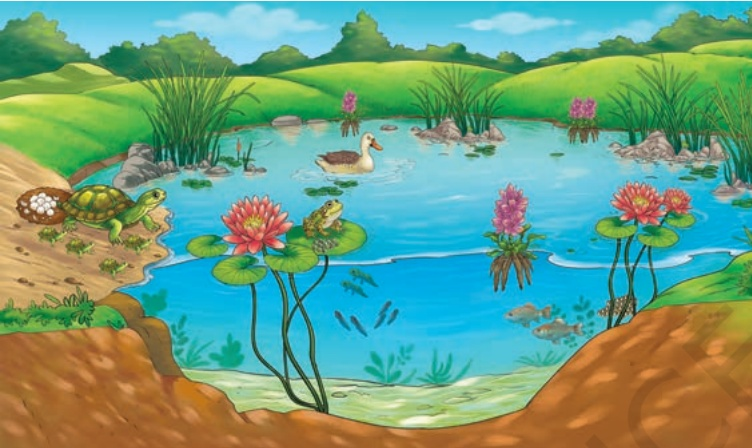
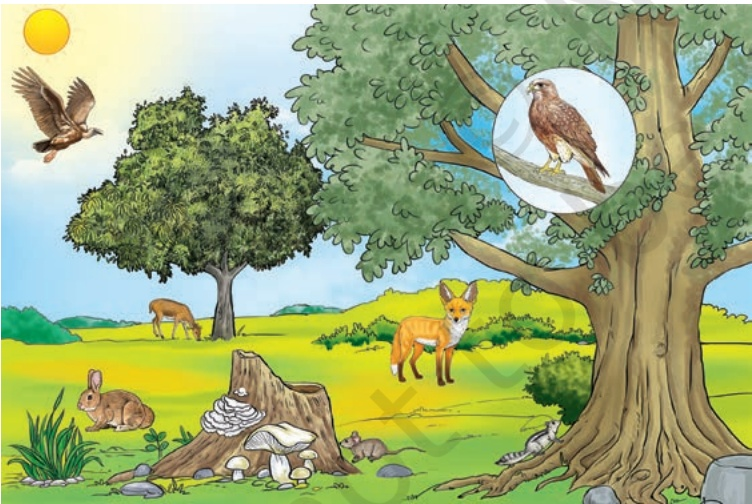

~~Table 12.1: Different compo~~nents of two habitats

<table><tr><td rowspan=2 colspan=3>Pond</td><td colspan=2>Forest</td></tr><tr><td>Living beings</td><td>Non-living things</td><td>Living beings</td><td>Non-living things</td></tr><tr><td></td><td>Fish</td><td>Water</td><td>Grass</td><td>Soil</td></tr><tr><td></td><td></td><td></td><td>Trees</td><td></td></tr><tr><td></td><td></td><td></td><td>Birds</td><td></td></tr></table>

(a) Pond habitat

(b) Forest habitat

What common characteristics do you observe in the two habitats in Activity 12.1? The similarities are that both habitats have living beings as well as non-living things. However, the types of living beings are different and the non-living things also vary. The living beings you have recorded in Table 12.1 are termed as the **biotic** components and non-living things as the **abiotic** components of a habitat. Have you wondered why some organisms live on land while others live in water? Every organism needs specific conditions to survive. From this activity, you can see that different habitats offer different living conditions.

In Activity 12.1, you listed fish as a biotic component of the pond. How do fish survive in a pond? A pond provides food, oxygen, shelter, and space to grow—conditions essential for survival of organisms. Fish obtain their biotic needs, such as food, from small plants and animals, and abiotic needs, such as oxygen, from water.

Fig. 12.1: Two types of habitats

Other living beings also inhabit the pond, such as frogs, turtles, snakes, dragonflies, mosquitos, snails, and ducks, along with plants like algae, diatoms, duckweeds, and lotus. They all interact with the other living beings and non-living things present in the places where they grow and thrive.