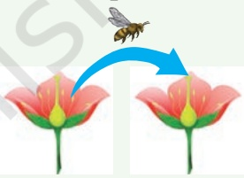
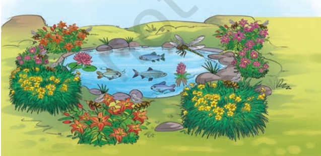
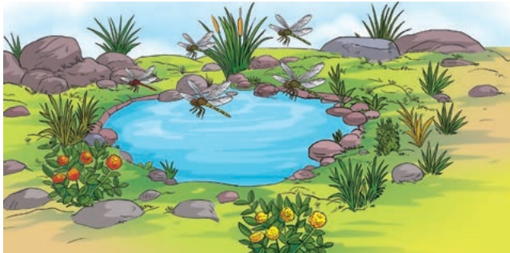

From Activity 12.2, we can explain that the population is a group of the same type of organisms in a habitat at a given time.

Can a habitat have only one type of living organism? What might happen then? If all organisms are the same, they would have the same requirements — food, water, space — leading to competition and possible scarcity of resources. What else do you think could happen?

In Activities 12.1 and 12.2, you observed that different group of organisms live together in a habitat. A **community** comprises different populations sharing the same habitat. The biotic components of a habitat, such as the plants, animals, and microorganisms together form the community. These organisms interact and depend on one another for survival.

## Ever heard of ...

You may have seen brightly coloured flowers blooming around you. Have you ever looked closely at their parts? A flower has a stalk, green leafy structures called **sepals**, coloured **petals** and two reproductive

parts — **Carpels** (female) and **stamens** (male). Stamens burst and release yellow dust like **pollen grains**. Wind, water, insects, bats, and birds help carry pollen from the stamens to the carpels of the same and/or different flowers. This process is called **pollination** (Fig. 12.2). It is essential for the formation of fruits and seeds.

Fig. 12.2: Insect pollination

## 12.3 Does Every Organism in a Community Matter?

Let us find out the role of different organisms in a community.

## Activity 12.3: Let us read

z Researchers **conducted** a study to see how fish in ponds affect seed production in the plants nearby. They observed

Pond A

Pond B

Fig. 12.3: Pond A with fish and Pond B without fish