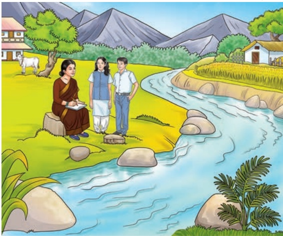
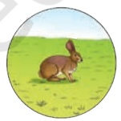
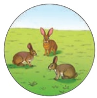
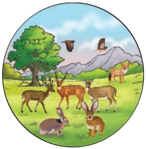
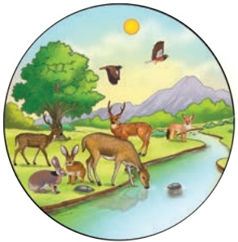

In Activity 12.4, you understood different types of interactions occur within a habitat. From this, you can infer that the biotic components (plants, animals, and microorganisms) and the abiotic components (air, water, soil, sunlight, and temperature) in a habitat interact with each other to form an **ecosystem**. Organisms in an ecosystem interact with abiotic components for food, shelter, and protection. Different communities of living organisms interact with abiotic components in an ecosystem. There are two main types of ecosystems in nature. **Aquatic ecosystems** include ponds, rivers, and lakes while **terrestrial ecosystems** include forests,

Fig. 12.6: Overlap of terrestrial and aquatic ecosystems

farms or even large trees like banyan, mango, or pilkhan. Hence, ecosystems can be large or small. Can you find overlapping ecosystems in Fig. 12.6?

Fig. 12.6 shows an overlap of different terrestrial and aquatic ecosystems. In this figure, you can see a small river (an aquatic ecosystem) along with mountains, forests, grassland, and farmland, which are examples of terrestrial ecosystems. Farmland is a **human-made ecosystem**. These ecosystems are interacting with each other at any given point.

In Activity 12.4, we have seen the importance of the components and their interactions in an ecosystem. For example, sunlight, carbon dioxide, and water are essential for producing food in plants; soil provides medium and essential nutrients for plant growth; air provides oxygen for respiration in plants as well as animals; water is essential for all living organisms. This shows how living organisms depend on the non-living component of an ecosystem.

Individual

Population

Just as biotic components depend on abiotic components, abiotic components are also influenced by biotic components. For example, plants release oxygen during photosynthesis, roots hold soil in place and prevent erosion, and plants retain soil moisture and help cool the atmosphere.

You can identify and study any ecosystem in your surroundings and observe different types of interactions among the biotic and abiotic components. While studying biotic interactions, notice how organisms depend on each other for food.

## Activity 12.5: Let us classify

Community

Observe Fig 12.1b, which illustrates a forest ecosystem.

Study the picture carefully and spot the organisms listed in Table 12.4.

Ecosystem Fig. 12.7: Individual to ecosystem