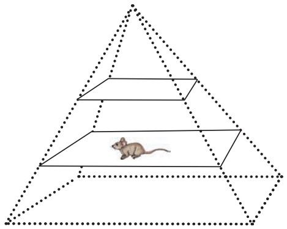
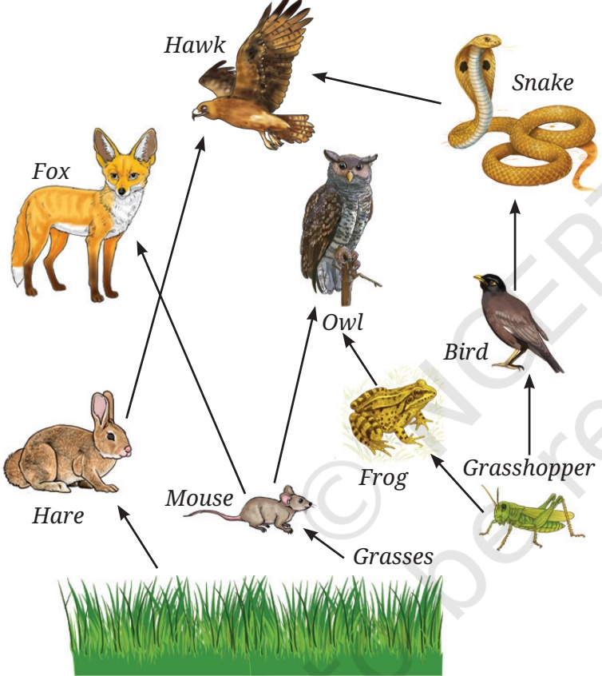
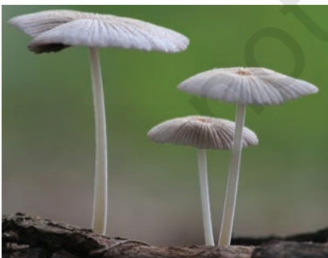

Fig. 12.10: (b) Food chain represented as a pyramid

Herbivores (like hares and deer) are at the second level.

z Small carnivores (like frogs) are at the third level.

Large carnivores (like tigers or vultures) occupy the next level.

## Activity 12.8: Let us trace and link

Look at Fig. 12.11.

Put more arrows for the missing relationship of ‘who eats whom’.

Fig. 12.11: Food web

How many other organisms might be connected to one organism through a feeding relationship in an ecosystem?

Observe the relationship between different food chains in an ecosystem. Are these food chains interlinked? Each of the organisms may be eaten by two or more types of organisms. Thus, in an ecosystem, the food chains are interlinked with each other to form a network, called a **food web**.

You know that living organisms grow, perform many functions, develop, and die. During their life cycle, organisms produce a lot of waste, including dead matter and food waste.

Fig. 12.12: Mushroom growing on dead organic matter

## 12.6 What Happens to Waste in Nature?

You may have seen small umbrella-like structures, mushrooms, growing on dead plants or trees during the rainy season (Fig. 12.12). These are a type of fungi that grow on dead matter. Microorganisms like fungi and bacteria break down complex substances in dead plants and animals into simpler ones. This process returns