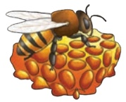
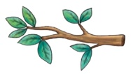
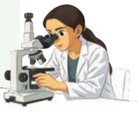

**Mutualism:** Both organisms benefit. For example: Honeybees and flowers.

**Commensalism:** One organism benefits while the other is not affected. For example: Orchids on trees.

Bee gets nectar (Benefitted)

**Parasitism:** One organism benefits while the other is harmed. For example: Ticks on the body of dogs.

Flower gets pollinated (Benefitted)

These interactions are all part of the complex web of life in an ecosystem.

Orchid gets physical support   (Benefitted)

Tree branch is unaffected

The dog gets skin irritation    (Harmed)

The tick feeds on dog blood    (Benefitted)

Fig. 12.16: Different types of interactions between organisms

## Be a scientist

Asir Jawahar Thomas Johnsingh (A.J.T. Johnsingh) was a famous Indian wildlife biologist who helped us understand forest ecosystems through the eyes of animals. He was a pioneer in studying wildlife through modern tracking system. His research showed how predators like tigers and leopards rely on prey, such as deer and wild boar, while he was working in Bandipur National Park, Karnataka. He proved that a healthy prey population is key to predator survival. He inspired many youngsters t<u>o study wildlife and protect the forests and biodiversity of India.</u>

## 12.9 What Are the Benefits of an Ecosystem?

We have learnt that biotic components and abiotic components of an ecosystem depend on each other and support various life processes. Humans also benefit from ecosystems. For example, forests provide fresh air, fertile soil, food, fibres, timber, and medicines. Similarly, aquatic ecosystems provide water and food. Ecosystems also offer aesthetic and recreational value. These support our well-being and shows how closely nature and humans are connected. However, when we overuse or misuse natural resources, we disturb the balance in nature.

Now let us look at a real-life example of a threatened ecosystem — the Sundarbans.