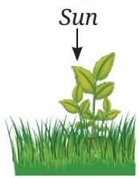
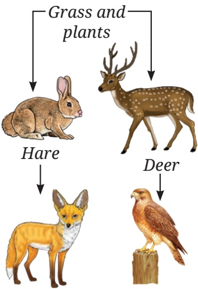
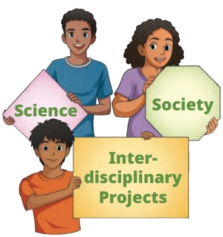
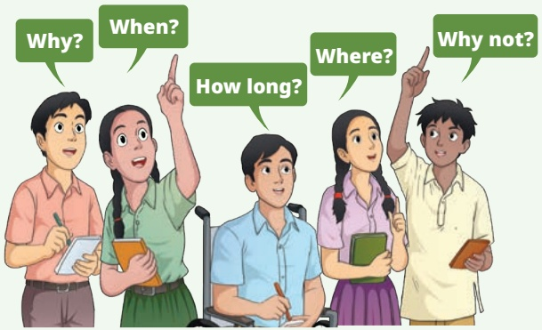

4. Look at this food chain:

Fox Eagle Fig. 12.20: Parts of a food web

Grass Grasshopper Frog Snake

If frogs disappear from this ecosystem, what will happen to the population of grasshoppers and snakes? Why?

5. In a school garden, students noticed fewer butterflies the previous season. What could be the possible reasons? What steps can students take to have more butterflies on campus?

6. Why is it not possible to have an ecosystem with only producers and no consumers or decomposers?

7. Observe two different places near your home or school (e.g., a park and a roadside). List the living and non-living components you see. How are the two ecosystems different?

8. ‘Human-made ecosystems like agricultural fields are necessary, but they must be made sustainable.’ Comment on the statement

9. If the Indian hare population (Fig. 12.20) drops because of a disease, how would it affect the number of other organisms?

## Discover, design, and debate

z Plan a clean-up day at school or a nearby park. Wearing gloves and using bags, collect the litter you find. Discuss the kinds of waste you found. Which was the most common? How can we reduce such waste?

In Arunachal Pradesh, the Nyishi and Mishmi tribes treat the Tiger as sacred. In Chhattisgarh, the Baiga tribe worships the Bagesur Dev and believes the Tiger is the protector of the forest. Find out about other Indian tribes that have a special connection with animals.

Pick a tree near your home or school. Observe it once a week for 4 weeks. Note any new leaves, flowers, fruits, or visiting birds and insects. Record your observations. You may even upload your findings to www.seasonwatch.in and become a young citizen scientist.

**Prepare some questions based on your learnings so far ...**

........................................................................................................................................................................................................................................................................................................................................................................................................................................ Reprint 2026-27