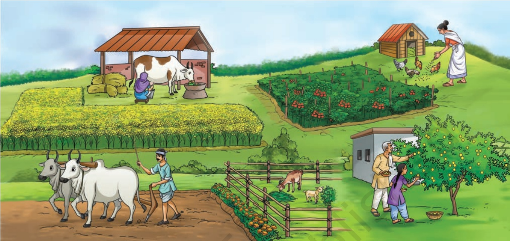

z Interact with farmers and record indigenous practices followed by them for sustainable farming. Create a sustainable herbal garden/natural farm at home or at school. It could be a group activity with students from different grades.

Fig. 12.21: Farming Practices

Look at Fig. 12.21 to understand the different farming practices adopted by farmers or you may also visit a nearby farm with an elderly person to observe the same. List a few suggestions in your notebook to improve farming practices by adopting eco-friendly and sustainable techniques. You can also make posters or model and display while participating in school functions, science fairs or Krishi Mela. The school may also invite agricultural scientists, farmers, and experts to discuss the prevalent farming practices with the students.

**Reflect on the questions framed by your friends and try to answer ...**

