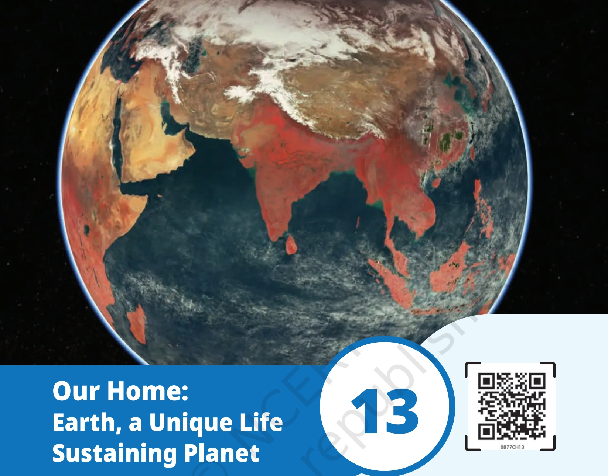

## Our Home: Earth, a Unique Life Sustaining Planet

z What do you think Earth would look like if there were no li e no life on it at all?

z Life on Earth has survived for billions of years. What all i ows t to keep going despite major changes and disasters?

z Why don’t dogs lay eggs? Or hens give birth to live chick ? s

z If a spaceship carried soil and water to Mars, could plants start ts start growing there?

Share your questions