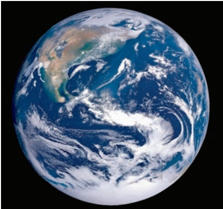
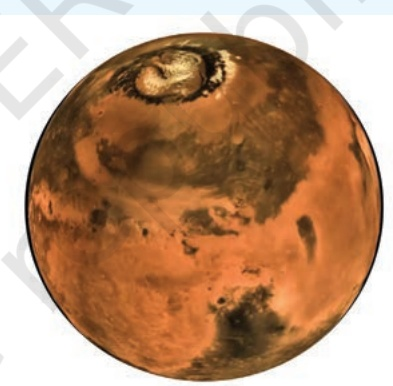

bacteria, can survive in frozen environments, from what we know so far, liquid water is essential for life to evolve. Earth’s distance from the Sun allows water to remain mostly in liquid form, which is essential for the development and sustenance of life in all its form. The range of distances from the Sun (or another star) over which water remains liquid is called the habitable zone, or sometimes also called the ‘Goldilocks zone’ (Fig. 13.4).

As you have also studied in Social Science, most of Earth’s surface is covered with water. Thus, when seen from space, the Earth looks blue because of the vast amount of water—hence the name Blue Planet (Fig. 13.5)

Fig. 13.5: Earth — The blue planet

## A step further

Did Mars ever support life?

Mars lies at the edge of the Sun’s habitable zone. Several spacecrafts have been sent to Mars, rovers have landed and explored its surface, but no proof of life has been found yet. However, scientists think that in the past, Mars may have had liquid water—maybe even some lakes—and conditions that could support simple life forms (Fig. 13.6).

This is one reason Mars continues to interest scientists. It also reminds us that science doesn’t always have final answers. As we explore more, we may find new clues—or even new kinds of life. Science stays open to change when we learn more.

Fig. 13.6: Mars

Is the temperature or distance from the Sun, the o<u>nly factor that makes the Earth habitable?</u>

What would happen if the size of the Earth <u>were too small or too big?</u>

## 13.3.2 Size of the Earth

There are some other important factors that make the Earth habitable. In our solar system, the orbits of most planets, including the Earth are almost circular. This keeps the amount of