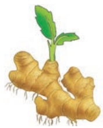
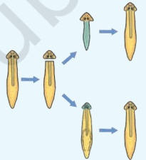

Can you observe and list some plants around you that grow this way?

How do bamboo and sugarcane grow into new plants? I have <u>never seen their seeds.</u>

## Activity 13.3: Let us find out

z Take some parts of plants like stem cutting of a money plant, the ‘eyes’ of a sprouted potato, or a piece of ginger (Fig. 13.11b).

z Plant each of them separately in moist soil (not too deep). For money plant, you can just put a cutting in a glass container which makes it easy to observe.

z Make sure they get all the conditions they need to grow—like water, air, and sunlight.

z Watch them every day and note how many days it takes for roots stem and leaves to appear. Also observe when the first new leaf appears.

(a)

(b)

## Ever heard oEver heard of ...

Not just plants – microbes and simple animals also reproduceot just plants—microbes and simple animals also reproduce asexually. For example, single-celled organisms like bacteria andsexually. For example, single-celled organisms like bacteria and amoebae divide into two identical individuals. Some multicellularmoeba divide into two identical individuals. Some multicellula

Fig. 13.11: Vegetative propagation — (a) Ginger; (b) Potato

organisms like algae can regrow from small cut parts.rganisms like algae can r grow from sm ll cut parts Hydra, another simple animal, grows tiny buds on itsydra, another simple animal, grows tiny buds on its body that break off and grow into new individuals.ody that breaks off and grow into new individuals.

Planaria (Fig. 13.12), a type of flatworm, can Planaria, a type of flatworm, can regrow from justregrow from a fragment of its body! Scientists study a small piece of their body! Scientists study them tothis organism to understand regeneration in animals.

Fig. 13.12: Planaria

## 13.5.2 Sexual reproduction

In this type of reproduction, two parents are involved—usually called male and female. This is easy to observe in animals, but did you know even flowering plants have male and female parts? Some microorganisms like bacteria and yeast also have two ‘mating types’ that act like the two parents.

## Special cells for reproduction

You might wonder if both parents pass on their genetic material for making a new organism, won’t the child end up with double the amount of instructions? And would not this keep doubling every generation?

This does not happen because each parent makes specialised reproductive cells, called gametes. These carry only half of the parent’s genetic material . When male and female gametes join, they form a new cell with a complete set of instructions — half from each parent.