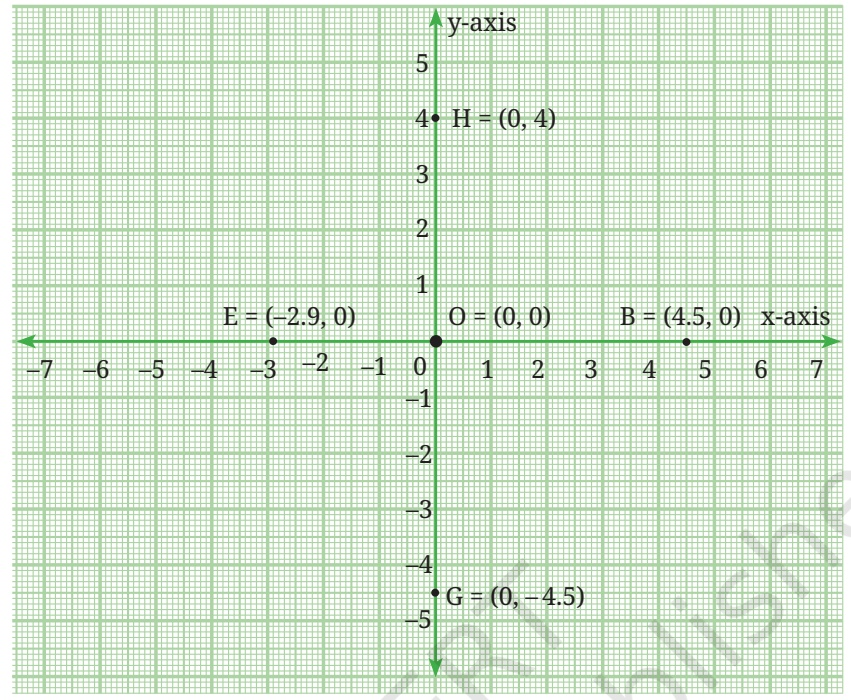

Fig. 1.2: Structure of the coordinate plane

Point B is on the x-axis and 4.5 units to the right of O, its coordinates are (4.5, 0). This fact is written as B = (4.5, 0). Point G is on the y-axis and 4.5 units downward from O, its coordinates are (0, – 4.5), that is, G = (0, – 4.5). Point H is also on the y-axis but 4 units above O, its coordinates are (0, 4), that is, H = (0, 4).

A point P = (x, 0) lies on the x-axis. If x is positive, then P lies to the right of O. If x is negative, P lies to the left of O. A point P = (0, y) lies on the y-axis. If y is positive, P lies above O; if y is negative, P lies below O.

While writing the coordinates of a point, it is often convenient to drop the ‘=’ sign and write P = (x, y) simply as P (x, y). This is especially true while marking points on a graph.

## Exercise Set 1.1

Fig. 1.3 shows Reiaan’s room with points OABC marking its corners. The x- and y-axes are marked in the figure. Point O is the origin.