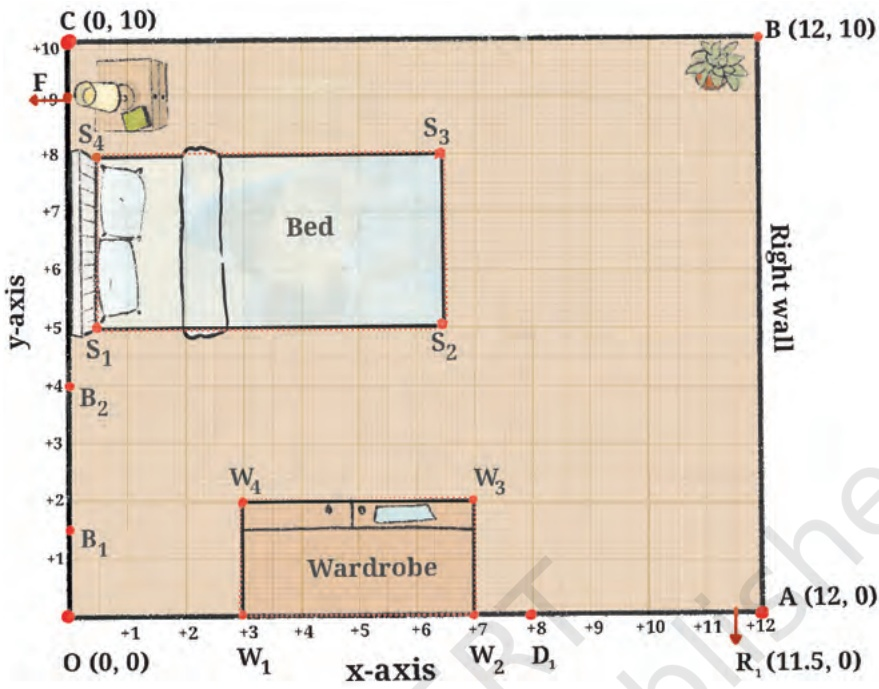

Fig. 1.3

Referring to Fig. 1.3, answer the following questions:

(i) If $\mathrm { D _ { 1 } R _ { 1 } }$ represents the door to Reiaan’s room, how far is the door from the left wall (the y-axis) of the room? How far is the door from the x-axis?

(ii) What are the coordinates of $\mathbb { D } _ { 1 } \mathbb { ? }$

(iii) If $\mathtt { R _ { 1 } }$ is the point (11.5, 0), how wide is the door? Do you think this is a comfortable width for the room door? If a person in a wheelchair wants to enter the room, will he/she be able to do so easily?

(iv) If $\mathrm { B } _ { _ 1 } \left( 0 , 1 . 5 \right)$ and $\mathrm{B_2}(0,4)$ represent the ends of the bathroom door, is the bathroom door narrower or wider than the room door?

## Think and Reflect

1. What are the standard widths for a room door? Look around your home and in school.

2. Are the doors in your school suitable for people in wheelchairs?