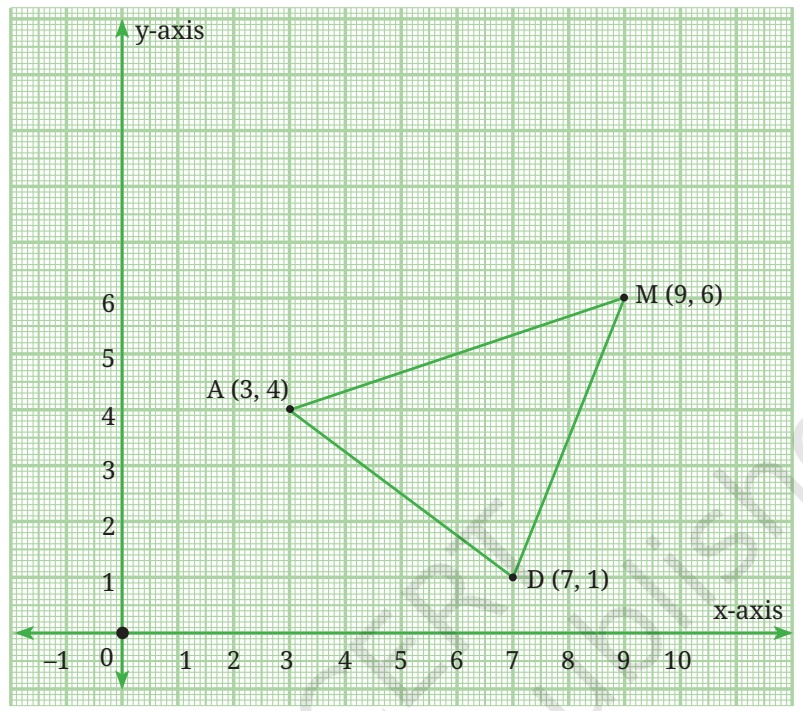

Look at triangle ADM in Fig. 1.6.

Triangle ADM is an acute angled triangle in the first quadrant. How do we find the lengths of its sides AD, DM and MA?

## Think and Reflect

1. In moving from A (3, 4) to D (7, 1), what distance has been covered along the x-axis? What about the distance along the y-axis?

2. Can these distances help you find the distance AD?

Fig. 1.7 gives us a clue. The distance moved along the x-axis is given by CD.

CD = x-coordinate of D – x-coordinate of A = 7 – 3 = 4.

The distance moved along the y-axis is given by AC.

AC = y-coordinate of A – y-coordinate of D = 4 – 1 = 3. Using the Baudhāyana–Pythagoras Theorem, we get the distance

$$
\mathrm{AD} = \sqrt{4^{2} + 3^{2}} = 5   units .
$$