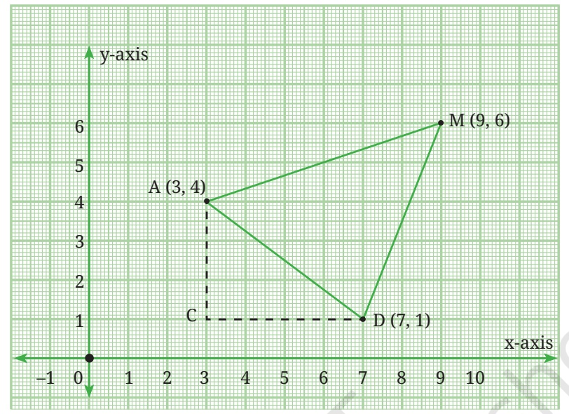
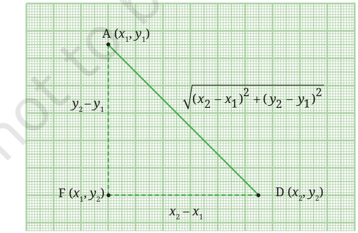

Fig. 1.7

We similarly find the distances DM and MA:

$$
DM  = \sqrt{2^2 + 5^2} = \sqrt{29}   units
$$

$$
\mathrm{MA} = \sqrt{6^{2} + 2^{2}} = \sqrt{40}   units.
$$

In general, the distance between the points $( \bar { x } _ { 1 } , y _ { 1 } )$ and $( x _ { 2 } , y _ { 2 } )$ is given by

$$
\sqrt{ \left( x_{2} - x_{1} \right)^{2} + \left( y_{2} - y_{1} \right)^{2} }
$$

and is cal<u>culated as shown in Fig. 1.8.</u>

