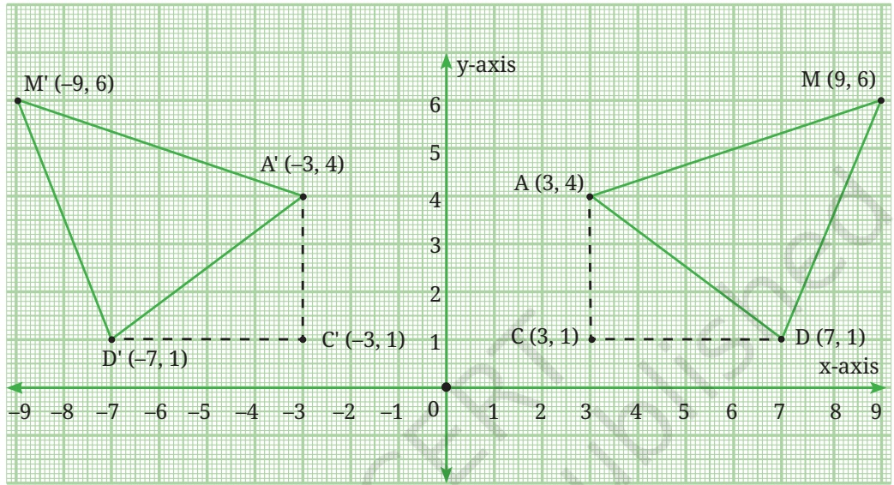

It makes no difference whether $( X _ { _ 2 } - X _ { _ 1 } )$ and $( y _ { _ 2 } - y _ { _ 1 } )$ are positive or negative, as we are simply measuring the shifts along the two axes.

What if, $X_{1}, X_{2}, Y_{3}, Y_{4}$ take negative values? In Fig. 1.9, triangle AMD is reflected in the y-axis. What are the coordinates of the images of points A, M, and D?

$$
\mathrm{CD}^{\prime}=\mathrm{x}-\mathrm{coordinate}-\mathrm{of} \mathrm{A}^{\prime}-\mathrm{x}-\mathrm{coordiintate},\mathrm{of} \mathrm{D}^{\prime}=-3-(-7)=4.
$$

$$
\mathrm{AC}^{\prime}=\mathrm{y-coordinate of A}^{\prime}-\mathrm{y-coordinate of D}^{\prime}=4-1=3.
$$

Using the Baudhāyana–Pythagoras Theorem, we get $\mathrm{AD} = \sqrt{4^{2} + 3^{2}} = 5$ units.

You can similarly calculate both D'M' and M'A':

$$
\mathrm{D}^{\prime} \mathrm{M}^{\prime}=\sqrt{(-2)^{2}+5^{2}}=\sqrt{29} \text { units }
$$

$$
\mathrm{M^{\prime}A^{\prime}} = \sqrt{(-6)^2 + 2^2} = \sqrt{40}   units.
$$

We see that reflection has preserved the lengths of the sides of the triangles.

## Think and Reflect

1. What has remained the same and what has changed with this reflection?

2. Would these observations be the same if ΔADM is reflected in the x-axis (instead of the y-axis)?