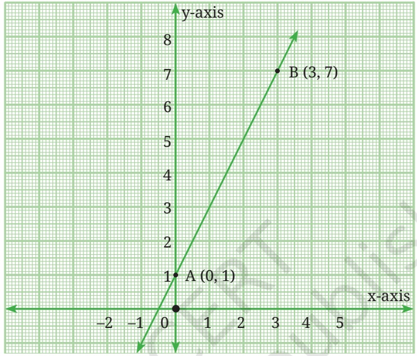

When x = 0, y = 1, so (0, 1) is a point on the line. We can call this point A. We say that the x-coordinate of A is 0 and the y-coordinate is 1. Also, when x = 3, y = 7. Thus, B (3, 7) is another point on the line. We plot these points on the coordinate plane, join them and extend the line in both directions as shown in Fig. 2.5.

Fig. 2.5: The straight line y = 2x + 1

## Think and Reflect

Identify other points on the line by completing the following table.

| x | 1 | 2 | 5 | 7 | 9 | 12 | 20 |
| --- | --- | --- | --- | --- | --- | --- | --- |
| y | 3 |  |  | 15 |  |  |  |

Note that (1, 3) and (7, 15) are also the points on the line y = 2x + 1. Plot the points on the line. You may use a graph paper for this task. Observe that if a point lies on a line, its coordinates must satisfy the equation of the line. Thus, we can verify that (7, 15) lies on the line y = 2x + 1 by substituting x = 7 and y = 15 in the equation.

**Example 12:** Let us plot the points (–1, –3), (0, 0), (1, 3), (3, 9), (4, 12) in the coordinate plane on a graph paper as shown in Fig. 2.6. Join the points (–1, –3) and (4, 12) using a ruler. Doing so, observe that all five points lie on a straight line. Can you guess the equation of this line by looking at the relationship between the x and y coordinates of each point?