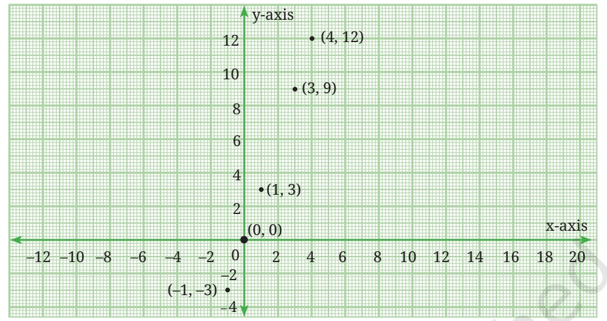
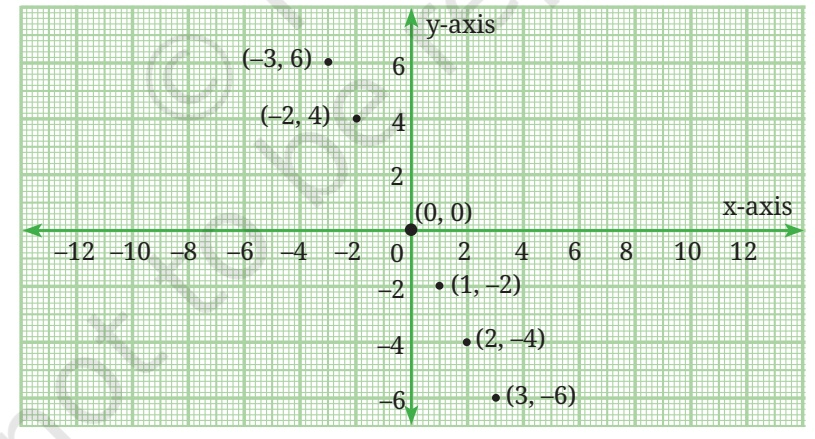

Fig. 2.6

For each point, the value of the y-coordinate is three times that of the x-coordinate. We can therefore say that y = 3x.

**Example 13:** Let us plot the points (– 3, 6), (– 2, 4), (0, 0), (1, – 2), (2, – 4), (3, – 6) in the coordinate plane on a graph paper as shown in Fig. 2.7. Join the points (– 3, 6) and (3, – 6) using a ruler. Doing so, observe that all five points lie on a straight line. Can you guess the equation of this line by looking at the relationship between the x and y coordinates of each point?

Fig. 2.7

**Example 14:** Draw the graphs of $y=\frac{1}{2}x,y=x,y=2x$ by selecting suitable points on these lines.

(**Hint:** In order to graph $y \; = \; { \frac { 1 } { 2 } } \; x ,$ we could take the points (0, 0) and (4, 2). Can you verify that these lie on the line?)