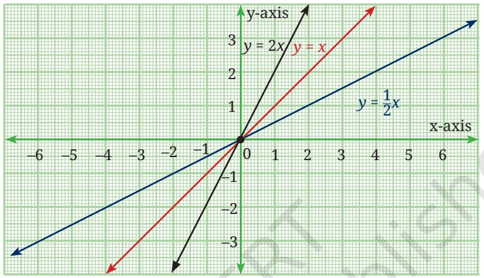

Fig. 2.9 shows all the three graphs on the same axes. Does this help you to conclude anything about the linear equation $y = a x , a > 0$ as a varies? What happens when $\mathbf { a } \geq 1$ and when $\mathtt { a } \leq 1 ?$

(**Hint:** You may also plot the equations $y \: = \: 3 x$ and $y = { \frac { 1 } { 3 } } \; x$ on the same axes.)

Fig. 2.9

First of all, we observe that the straight lines representing an equation of the form y = ax, always pass through the origin (0, 0). Further, when $a \geq 1$ , the line is steeper than the line $y \: = \: x ,$ which is equally inclined to both axes. However, when $a \leq 1$ , the line is less steep than the line $y = x .$ In fact, a is referred to as the **slope** of the line $y = a x .$ We will learn more about the concept of the **slope** of a line in the chapter on linear equations.

For now, we focus on another important observation. A linear growth is represented by a straight line with positive slope while a linear decay is represented by a straight line with negative slope. Note that the number of square tiles in the pattern in Fig. 2.4 leads to the sequence 1, 3, 5, 7, …. in which the difference of consecutive terms is the constant 2. The slope of the line representing the linear relationship between the term number and the number of square tiles is $y = 2x - 1$ . Hence, the slope represents the constant difference between consecutive terms of the sequence.

**Example 15:** Now let us draw the graphs of $y=\frac{-1}{3}x,y=-x,y=-3x$ by selecting suitable points on these lines. Fig. 2.10 shows the graphs of these linear equations without any points labelled on them.