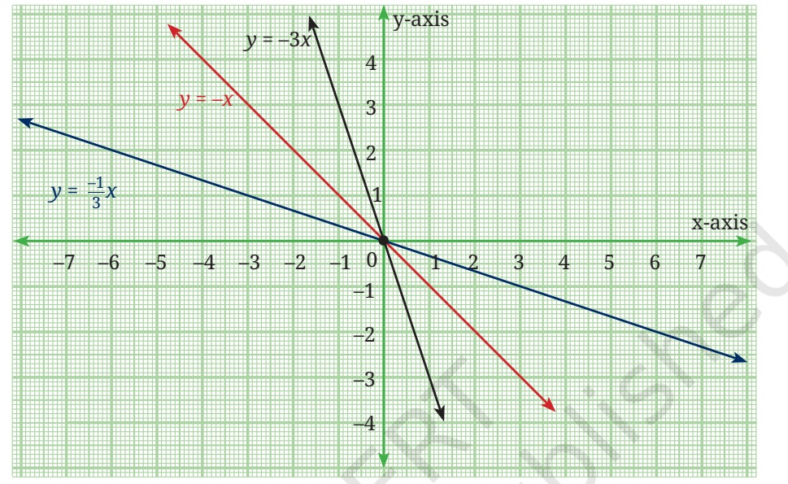
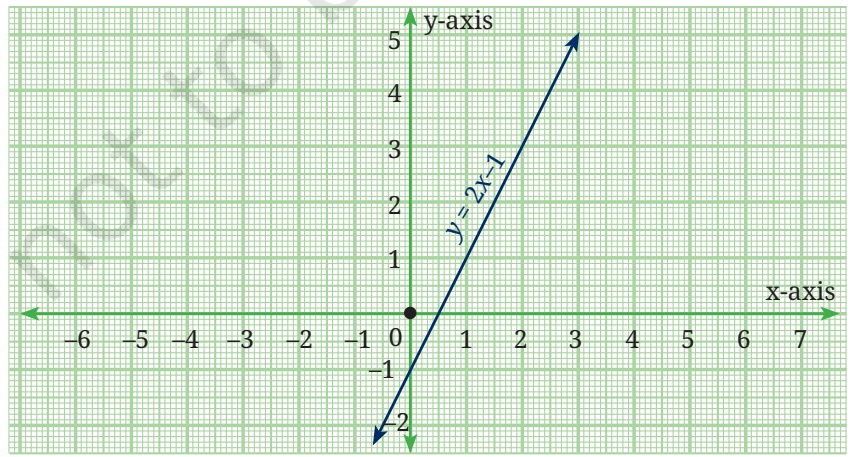

Fig. 2.11 shows all the three graphs on the same axes. Does this help you to conclude anything about the linear equation y = – ax, a > 0, as a vari<u>es? What will happen when a > 1 and when a < 1?</u>

## Think and Reflect

Differentiate between the graphs of the equations y = 3x + 1, and y = –3x + 1.

**Example 16:** Let us now draw the graphs of y = 2x – 1, y = 2x + 1, y = 2x + 5, first individually (as shown in Fig. 2.12) and then on the same axes (as shown in Fig. 2.13).

Fig. 2.12 A