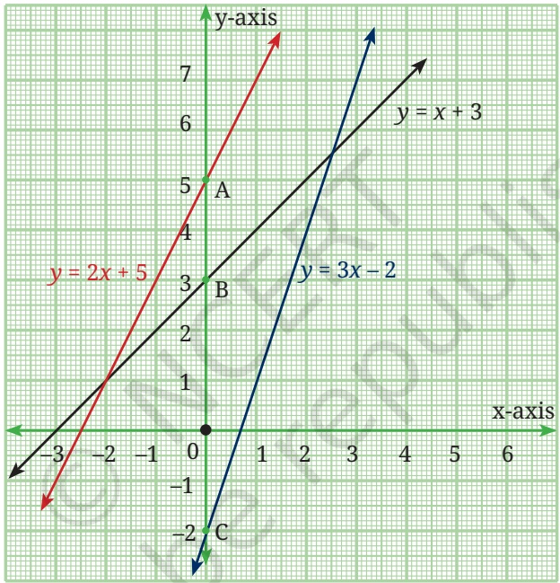

## Think and Reflect

Does this help you to conclude anything about the linear equation $y = a x + b$ when a is fixed but b varies?

(**Hint:** In these equations a = 2, and b takes the values –1, 1 and 5, respectively.)

Now let us draw the graphs of the equations $y = x + 3, \\ y = 2x + 5$ and $y = 3 x - 2$ . See Fig. 2.14 and observe where these lines cut the y-axis.

Fig. 2.14

We see that,

$y = 2x + 5$ cuts the y-axis at A (0, 5),

$y = x + 3$ cuts the y-axis at B (0, 3), and

$y = 3x - 2$ cuts the y-axis at C (0, –2).

We observe that any straight line written in the form y = ax + b cuts the y-axis at the point (0, b). The length b is referred to as the y-intercept of the line. Thus, the y-intercept of the line y = x + 3 is 3. This means that the line cuts the y-axis at a distance of 3 units from the origin in the positive direction. Similarly, the y-intercept of the line $y = 3x - 2\  is  -2$