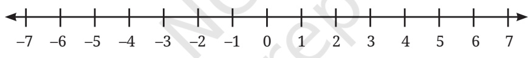
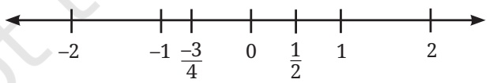

$$
-\frac{4}{7}{\div}\frac{5}{14}\tag{iii}
$$

6. Show that: $\left( \frac{1}{2} + \frac{3}{4} \right) \times \frac{8}{3} = \frac{1}{2} \times \frac{8}{3} + \frac{3}{4} \times \frac{8}{3}$

7. Simplify the following using the distributive property: ${ \frac { 7 } { 9 } } { \Bigg [ } { \frac { 6 } { 7 } } { - } { \frac { 3 } { 4 } } { \Bigg ] } .$

8. Find the rational number x such that: $\frac{5}{6}\left(X + \frac{3}{5}\right) = \frac{5}{6}X + \frac{1}{2}$

## 3.4.1 Representation of Rational Numbers on the Number Line

We already know that integers can be represented on a number line. To do this, we first choose a point and mark it as 0, called the origin. Moving one unit to the right gives the point representing 1, two units to the right gives 2, and so on. Similarly, moving one unit to the left of the origin gives –1, two units to the left gives –2, and so on. Each integer lies at an equal distance from the next one. This is represented in Fig. 3.3.

Fig. 3.3

Rational numbers can also be represented on the number line. Unlike integers, they may lie between two integers. For example, $\frac { 1 } { 2 }$ lies exactly halfway between 0 and 1, and $-\frac{3}{4}$ lies between –1 and 0 as shown in Fig. 3.4.

Fig. 3.4

To represent a rational number $\frac { p } { q } ,   q \neq 0$ , on the number line, divide the unit interval (the distance between two consecutive integers) into q equal parts. Then move p parts from 0 to the right if the number is positive, and to the left if it is negative.