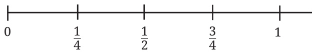
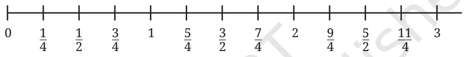
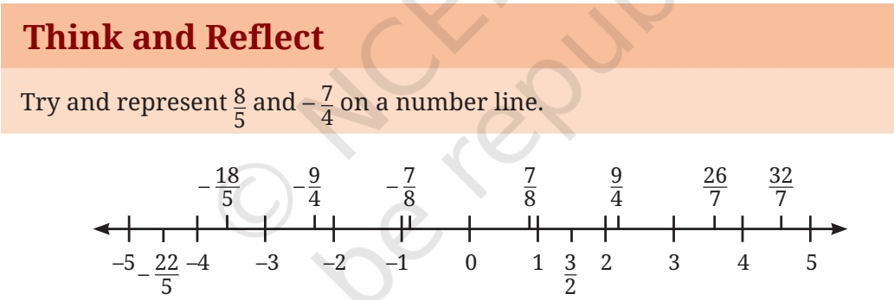

For example, to represent $\frac{3}{4},$ divide the interval between 0 and 1 into four equal parts and move three parts to the right from 0.

Fig. 3.5

Even fractions greater than 1 can be located on the number line in this way. For example, ${ \frac { 9 } { 4 } } = 2 { \frac { 1 } { 4 } }$ so it lies between 2 and 3. We divide the interval between 2 and 3 into four equal parts and move one part to the right of 2. See Fig. 3.6.

Fig. 3.6

## Think and Reflect

Try and represent $\frac{8}{5}  and  -\frac{7}{4}$ on a number line.

Fig. 3.7: Some integers and rational numbers on a number line

## Absolute value of a rational number

The **absolute value** of a rational number $X ,$ written as $| x |$ , represents its distance from 0 on the number line.

**Example 1:** $\left| \frac{5}{3} \right| = \frac{5}{3}, \left| -\frac{5}{3} \right|$ is also equal to $\frac { 5 } { 3 }$ and $| 0 | = 0$

Thus, the absolute value of a positive number is the number itself. The absolute value of a negative number is its positive value. Therefore, the absolute value of any rational number is always non-negative, that is, $| x | \geq 0$