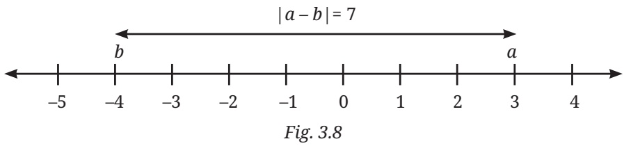
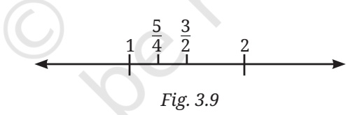

For two rational numbers a and b, the distance between them on the number line is given by $| a - b |$ . Fig. 3.8 represents the distance between the integers –4 and 3.

## 3.4.2 The Density of Rational Numbers

One of the most magical properties of rational numbers is that they are dense. Between any two integers, say 1 and 2, there is a rational number $\frac { 3 } { 2 }$ . Between 1 and $\frac { 3 } { 2 }$ , there is another rational number ${ \frac { 5 } { 4 } } .$

No matter how close two rational numbers are on the number line, you can always find another rational number between them by taking their average. For example, a rational number between 1 and

$\frac { 3 } { 2 }$ can be found by taking their average: $\frac{1 + \frac{3}{2}}{2} = \frac{5}{4}$ . Try to explain why the average of two rational numbers a and b, which equals $\frac { ( a + b ) } { 2 }$ , is always a rational number between a and b.

This means that there are infinitely many rational numbers between any two points. It feels as though the rational numbers must completely fill the number line, leaving no gaps whatsoever. But do they?

## Exercise Set 3.4

1. Represent the rational numbers ${ \frac { 2 } { 3 } } , - { \frac { 5 } { 4 } }$ and $1 { \frac { 1 } { 2 } }$ on a single number line.

2. Find three distinct rational numbers that lie strictly between $- { \frac { 1 } { 2 } } \operatorname { a n d } { \frac { 1 } { 4 } } \cdot$