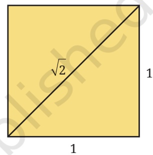

3. Simplify the expression: $\left( - \frac{1}{4} \right) + \left( \frac{5}{12} \right)$

4. A tailor has 15 $\frac { 3 } { 4 }$ metres of fine silk. If making one kurta requires $2 { \frac { 1 } { 4 } }$ metres of silk, exactly how many kurtas can he make?

5. Find three rational numbers between 3.1415 and 3.1416.

\*6. Can you think of other way(s) to find a rational number between any two rational numbers?

## 3.5 Irrational Numbers

For centuries, mathematicians believed that every measurable length in the universe could be represented as a ratio of two integers. However, when Baudhāyana composed his Śhulbasūtra (a manual for constructing complex geometric fire altars) in around 800 BCE, he quickly encountered lengths that defied fractions. The ancient Greeks encountered the same crisis a few centuries later.

Fig. 3.10

Consider a square where each side is exactly

1 unit long. By the Baudhāyana–Pythagoras Theorem, the length of the diagonal d is given by $1^{2} + 1^{2} = d^{2}$ , so $\widehat{d^{2}} \leq 2.$ . Therefore, the length of the diagonal is $\sqrt { 2 }$

## Think and Reflect

Can $\sqrt { 2 }$ be written as a rational number $\frac { p } { q } \underset { \bullet } { \cap }$

As you learned in Grade 8, the answer is a resounding NO! We will soon again see why! Numbers on the number line that cannot be expressed as a ratio of integers are called **Irrational Numbers**.

## 3.5.1 The Proof of Irrationality of $\sqrt { 2 }$

The first proof of the irrationality of $\sqrt { 2 }$ is due to a mathematician named Hippasus who was a member of the Pythagorean school (c. 400 BCE). To explain why $\sqrt { 2 }$ is irrational, he employed a brilliant