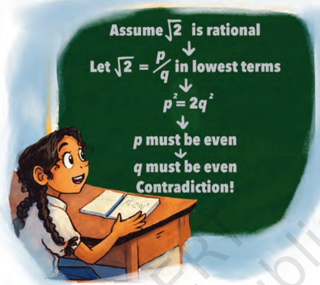

Because our logical steps are flawless, our initial assumption must be wrong. Therefore, $\sqrt { 2 }$ cannot be expressed as a fraction. It is irrational.

## Think and Reflect

Try to prove the irrationality of $\sqrt { 3 }$ using the approach of proof by contradiction. Will the same approach work for ${ \sqrt { 5 } }   ,   { \sqrt { 7 } }$ , or 10 ?

## 3.5.2 Construction of Length $\sqrt { \mathrm { n } }$

## Think and Reflect

We have seen how to obtain a line whose length is a rational number. How do we obtain lines whose lengths are irrational?

For example, to construct a line segment of length $\sqrt { 2 }$ and mark its position on the number line, we may proceed as follows.

**Step 1:** On the number line (see Fig. 3.11), we measure OA = 1 unit and draw a perpendicular on OA through A.