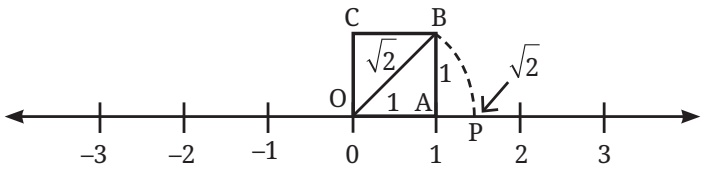

**Step 2:** On this perpendicular line we mark the point B such that $\mathrm { A B } = 1$ unit and join the origin to B. Clearly, $\mathrm { O B } = { \sqrt { 2 } }$ units.

**Step 3:** With O as centre and OB as radius, with a compass we draw an arc which intersects the number line at P. Clearly, $\mathrm { O P } = { \sqrt { 2 } }$ units. Hence, P represents the irrational number $\sqrt { 2 }$

Fig. 3.11: Constructing irrational lengths and locating them on the number line

## Think and Reflect

Try to extend this method for constructing line segments of lengths $\sqrt { 3 }$ and $\sqrt { 5 }$ using a ruler and a compass. Generalise this method to construct a line segment of any length of the form $\sqrt { n }$ , where n is a positive integer.

## 3.5.3 The Story of Pi (π) and Madhava’s Infinite Series

Another famous irrational number is $\pi ,$ the ratio of a circle’s circumference to its diameter. For centuries, mathematicians sought better and better fractional approximations for π. Āryabhaṭa (499 CE) gave the highly accurate approximation $\frac{3927}{1250} = 3.1416$ , but stated that this was only an asanna (approximation), and indicated that an exact fraction could likely not be found.

However, because π is irrational (as was formally proven by Lambert in 1761), no single fraction (or finitely many fractions) can ever provide a perfect formula for $\pi .$ An exact formula for π was first unlocked in the 14th century by **Mādhava of Sangamagrama**, who launched the Kerala School of Mathematics. Mādhava realised that to express an irrational number, you cannot use a single fraction; you must use an infinite sum. He discovered the profound infinite series:

$$
\pi = 4 \times \left(1 - \frac{1}{3} + \frac{1}{5} - \frac{1}{7} + \cdots\right).
$$

We know what it means to add 2, 100, or even a lakh terms. What does it mean to add an infinite number of terms? It means finding the