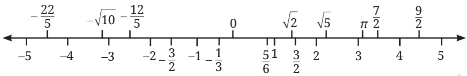

value that we get “closer” and “closer” to as we add more and more terms of the infinite sum, starting from the first term. You will learn more about infinite series in higher grades.

Thus, the number line is not only filled with rational numbers but also contains irrational numbers. We have seen how to mark some irrationals, and will simply conceive the rest of the irrationals to lie on the line.

Fig. 3.12

## 3.6 Real Numbers: Decimals and Cyclic Patterns

When we unite the dense web of Rational Numbers with the unfillable gaps of Irrational Numbers, we create the unbroken, continuous line of the Real Numbers (R).

The easiest way to distinguish a rational number from an irrational number is to look at its decimal expansion.

## 3.6.1 Rational Decimals: Terminating and Repeating

If you divide the numerator of a rational number by its denominator, exactly one of two things will happen:

1. **It terminates:** The division eventually leaves a remainder of 0. The decimal stops.

Example $2:\frac{3}{8}=0.375$ . (Can you tell for which rational numbers the decimal will be terminating?)

2. **It repeats:** The division never reaches a remainder of 0, but the sequence of digits begins to loop infinitely.

Example $3:\frac{5}{11}=0.454545\cdots=0.\overline{45}.$

## Think and Reflect

Try to find the decimal expansions of $\frac { 1 0 } { 3 }$ and $\frac { 1 1 } { 1 2 }$ What do you observe about the repetition of the digits after the decimal point?