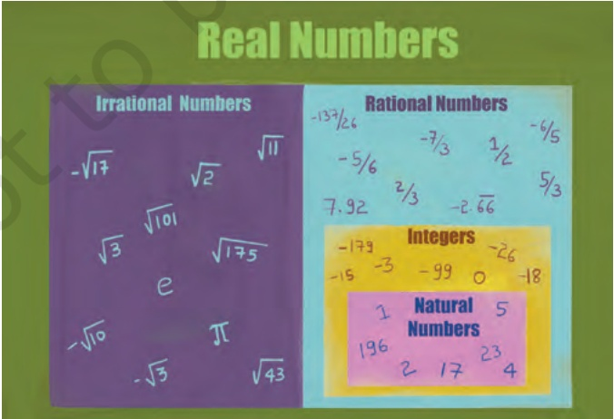

profound philosophical void of $\check { S } h \bar { u } n y a$ in ancient India. We crossed the threshold of zero into the realm of debts and negative numbers with Brahmagupta. We found that the space between numbers is infinitely dense with fractions, yet fundamentally interspersed with the infinite-nonrepeating-decimal irrational numbers like $\sqrt { 2 }$ and π. By uniting the rational and the irrational, we built the continuous, unbroken **Real Number Line**. Every length, every temperature, every real physical measurement in the known universe has a home on this line.

## The Evolution of Our World of Numbers

Our world of numbers has grown in stages over thousands of years, to meet the needs of humanity:

Natural Numbers ( ): The basic counting numbers $\{ 1 , 2 , 3 , . . . \}$ These are contained in the collection of integers.

Integers (Z): These include also zero and the negative numbers $\{ \ldots ,   - 2 ,   - 1 ,   0 ,   1 ,   2 , \ldots \}$ These in turn are contained in the collection of rational numbers.

$$
\frac { p } { q }
$$

Rational Numbers (Q): These include all fractions where p, q are integers and $q \neq 0$ They also correspond to those numb<u>ers wit</u>h terminating decimals like 0.135 and repeating decimals like 0.142857.

Irrational Numbers (I): These are separate from the above. They are numbers that cannot be written as fractions $( \mathrm { e . g . } ,   \sqrt { 2 } , \pi ,   \sqrt { 1 0 } )$ and do not have terminating or repeating decimals.

Real Numbers (R): Together, the **rational** and **irrational** numbers make up the entire real number line.

Fig. 3.13