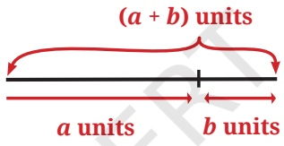
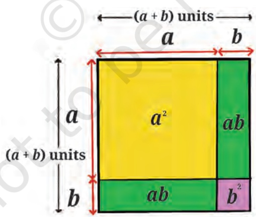

## Think and Reflect

Try and find other patterns like this one. For example, you could consider 4 consecutive squares and see if you can find a pattern.

## 4.2 Visualising Identities

In this section we will revisit some algebraic identities that we have studied in earlier grades and try to visualise them using geometrical models. In particular, we will use squares and rectangles to represent terms.

Consider two line segments of lengths a and b units, respectively, and make a longer line segment of length (a + b) units as shown in Fig. 4.1.

Fig. 4.1

We can now construct a square of side $(a + b)$ units and partition it into smaller squares and rectangles as shown in Fig. 4.2.

Fig. 4.2: Square of side (a + b) units

Observe that the area of the outer square is $( a + b ) ^ { 2 }$ . The area of the larger square inside the outer square is $a ^ { 2 }$ while the area of the smaller