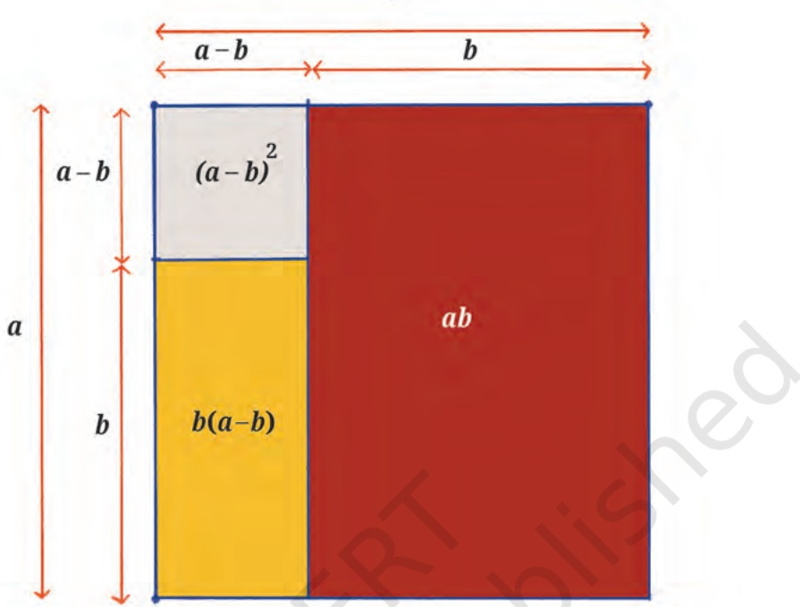

Fig. 4.3: A square of side a units

The area of the big square is $a ^ { 2 }$ square units. The small square has an area of $( a   -   b ) ^ { 2 }$ square units. The larger rectangle has area $a b$ square units while the smaller rectangle has area b $( a - b )$ square units. Thus, to obtain $( a - b ) ^ { 2 }$ we can subtract the areas of the rectangles from the big square.

We obtain $\begin{aligned}(a - b)^{2} &= a^{2} - ab - b(a - b) = a^{2} - ab - ba + b^{2} \\&= a^{2} - 2ab + b^{2}.\end{aligned}$

## Exercise Set 4.2

1. Factor completely:

(i) $9x^{2} + 24xy + 16y^{2}$

(ii) $4 s ^ { 2 } + 2 0 s t + 2 5 t ^ { 2 }$