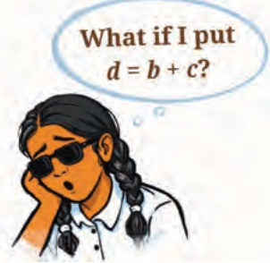
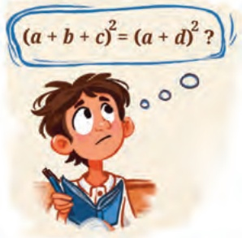

(iii) 49x2 + 28xy + 4y2

(iv)

$$
64p^{2}+\frac{32}{3}pq+\frac{4}{9}q^{2}\tag{*(v}
$$

$$
3a^{2}+4ab+\frac{4}{3}b^{2}
$$

$$
\frac{9}{5}s^{2}+6sv+5v^{2}
$$

(**Hint:** 2 was taken out as a common factor in Example 7. Is it possible to do something similar in Exercises (v) and (vi) above?)

2. Find the values of the following using the identity $(a - b)^{2} = a^{2} - 2ab + b^{2}.$ (i) $( 7 9 ) ^ { 2 }$ (ii) (193)2 (iii) (299)2

## 4.4. More Identities

What will happen if we want to find the square of the sum of three numbers $a ,$ b and $c ,$ that is, $(a + b + c)^{2}?$

Let us replace $b + c$ by d.

We already know, $(a + d)^{2} = a^{2} + 2ad + d^{2}.$

Thus, replacing d by $( b \quad + \quad \bar { c } )$ , we get $a^{2}+2ad+d^{2}=a^{2}+2a(b+c)+(b+c)^{2}.$

$$
\mathrm{So},(a+b+c)^{2}=a^{2}+2ab+2ac+b^{2}+2bc+c^{2}.
$$

It may be more convenient to remember this as.

$$
(a+b+c)^{2}=a^{2}+b^{2}+c^{2}+2ab+2bc+2ca.
$$

Let us interpret this geometrically by drawing a square of side $a + b + c$ as shown in Fig. 4.4.

