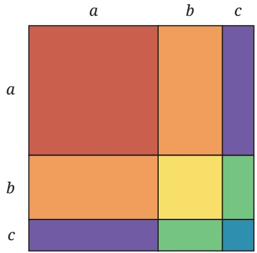

Fig. 4.4: A geometrical model representing the identity $(a+b+c)^{2}=a^{2}+b^{2}+c^{2}+2ab+2bc+2ca$

## Think and Reflect

Label the squares and rectangles in Fig. 4.4 so that it represents the identity $(a+b+c)^{2}=a^{2}+b^{2}+c^{2}+2ab+2bc+2ca.$

**Example 9:** Let us use this identity to find the square of a number, say 119:

$$
\begin{aligned}119^{2} &= (100 + 10 + 9)^{2} \\&= 100^{2} + 10^{2} + 9^{2} + 2(100)(10) + 2(100)(9) + 2(10)(9) \\&= 10000 + 100 + 81 + 2000 + 1800 + 180 = 14161.\end{aligned}
$$

So far we have verified the following three identities and used them for performing calculations and manipulating algebraic expressions:

1. $(a+b)^{2}=a^{2}+2ab+b^{2}$

2. $(a - b)^{2} = a^{2} - 2ab + b^{2}$

3. $(a+b+c)^{2}=a^{2}+b^{2}+c^{2}+2ab+2bc+2ca$

## Exercise Set 4.3

1. Find the following squares using one of the above identities. Determine which of these identities will make these calculations easier. (i) $1 1 7 ^ { 2 }$ (ii) $7 8 ^ { 2 }$ (iii) $1 9 8 ^ { 2 }$ (iv) $2 1 4 ^ { 2 }$ (v) $1 1 0 4 ^ { 2 }$ (vi) $1 1 2 0 ^ { 2 }$